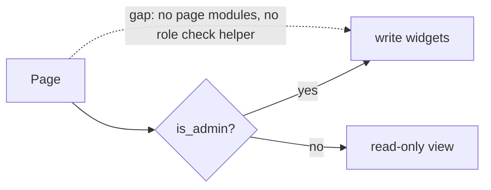
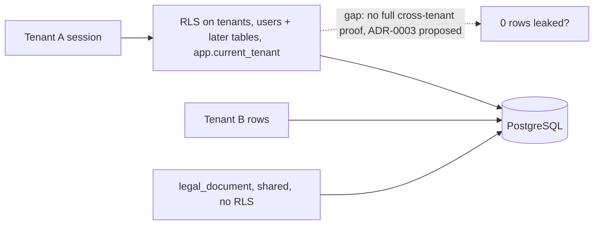
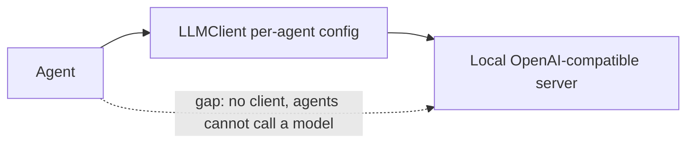
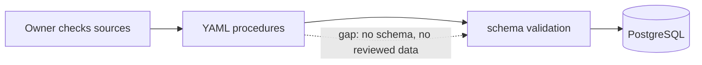
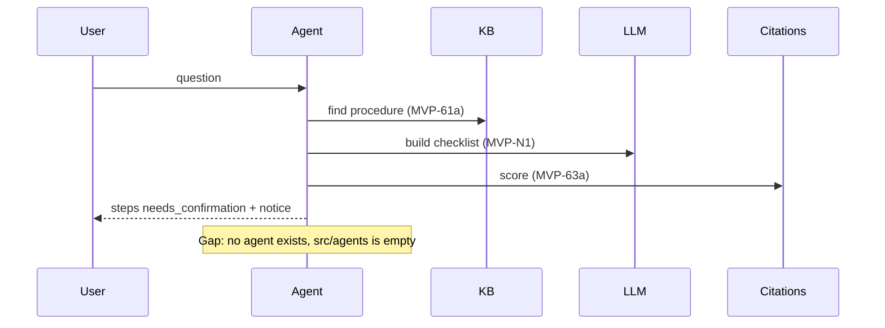
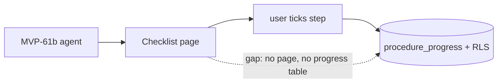
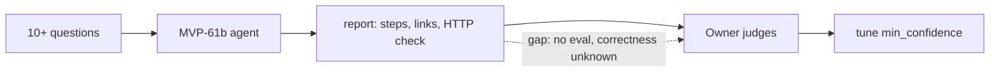

# Tickets: auth, tenant tests, LLM client, bureaucracy assistant

Common quality gate (code tasks): `ruff check`, `ruff format --check`, `pyright`, `.venv/bin/pytest -m "not integration"`.
Path note: paths marked (new) do not exist now. Imports are bare, because setuptools uses `where=["src"]`. Write `from config.settings import ...` and `from core.security.rbac import ...`. Never write the `src.` prefix.
Real tree now: `src/core/security/` has `passwords.py`, `rbac.py`, `tenant.py`. `src/ui/components/` has only `__init__.py` and `README.md`. `src/ui/pages/` has no page modules. `src/storage/` and `src/data/` have no code. `src/tasks/` has `celery_app.py` only. `tests/` has `unit/{config,plugins}` and `integration/plugins` only.

---

## MVP-52a Login UI with streamlit-authenticator (ADR-0013)

**Context.** Ticket MVP-52 still says JWT. ADR-0013 (accepted) replaced it. The user needs a login page with bcrypt and a signed cookie, and `tenant_id` must reach the tenant contextvar.
**Scope.** `login_form()`, `logout_button()`, `require_auth()`, `get_current_user()`, `is_admin()`, `require_admin()`. Users from PostgreSQL `users`/`tenants`; dev admin when no DB. **Non-goals:** JWT, public API, RBAC on pages (MVP-52b), password reset.
**Files.** `src/ui/components/auth.py` (new, does not exist), `src/core/security/passwords.py` (exists, reuse), `src/core/security/tenant.py` (exists, reuse), `tests/unit/test_ui_auth.py` (new). Imports: `from core.security.passwords import ...`, `from core.security.tenant import ...`.
**Depends on:** none. **Blocks:** MVP-52b.

Acceptance (Gherkin)
```gherkin
Scenario: Wrong password
  Given the login page is open and user "alice" exists
  When "alice" submits a wrong password
  Then the page shows an error and session user is None
Scenario: Right password
  When "alice" submits the right password
  Then session user is "alice" with her role
  And the current tenant contextvar equals her tenant_id
Scenario: Logout
  Given "alice" is logged in
  When she clicks logout
  Then session user is None and the tenant contextvar is cleared
Scenario: No database
  Given no DB is reachable
  Then the bundled dev admin can log in
```
**Test plan.** Unit, Streamlit `AppTest`, in `tests/unit/test_ui_auth.py`. Mock the user store.
**Quality gate.** Common.

```mermaid
flowchart LR
  U[User] --> L[login_form] --> A[streamlit-authenticator + bcrypt] --> S[session user, role, tenant_id]
  S -.gap: auth.py does not exist.-> T[tenant contextvar]
```
### After
Fill after merge: diagram of what was built.

---

## MVP-52b RBAC wiring on all pages

**Context.** `admin` manages data, `user` is read-only (ADR-0013). Pages must hide write actions from `user`.
**Scope.** Gate every write widget (fetch, approve, re-run) with `is_admin()`. Add a helper `admin_only(...)`. **Non-goals:** new roles, row-level rules.
**Files.** `src/ui/components/auth.py` (created in MVP-52a), `src/ui/pages/*.py` (no page modules exist yet: gate each page when it is added), `src/core/security/rbac.py` (exists), `tests/unit/test_ui_rbac.py` (new).
**Depends on:** MVP-52a. **Blocks:** MVP-26c, MVP-35b, MVP-56b, MVP-61c.
**OPEN:** MVP-12 (minimal Streamlit fetch page) writes data and may need MVP-52b. Owner decides whether MVP-12 depends on MVP-52b.

```gherkin
Scenario: User role is read-only
  Given "bob" is logged in with role "user"
  When he opens each page
  Then 0 write widgets (buttons or forms with a write action) are rendered
Scenario: Admin sees writes
  Given "root" is logged in with role "admin"
  Then every write widget is rendered
Scenario: Not logged in
  Given no session user
  When any page loads
  Then the page stops and shows the login form
Scenario: Forced call
  Given role "user"
  When code calls an admin-only function
  Then PermissionError is raised
```
**Test plan.** Unit, `AppTest` per page, `tests/unit/test_ui_rbac.py`.
**Quality gate.** Common.


### After
Fill after merge: diagram of what was built.

---

## MVP-53b Tenant leak tests and ADR-0003 acceptance

**Context.** Migration 4439761c5e40 enables RLS on two tables only: `tenants` (policy `tenants_isolation`) and `users` (policy `users_isolation`). `legal_document` has NO RLS, because documents are shared (ADR-0003). The MVP needs a clear proof: 0 cross-tenant rows on tenant-owned tables. ADR-0003 is `proposed` and names Chroma and Memgraph.
**Scope.** Integration tests that read and write as tenant A against tenant B on: `tenants`, `users`, and every new tenant-owned table when its task adds it (notes, state, failed tasks `failed_tasks`, `procedure_progress`). Each later task adds its own case to the same file. A test must not claim `legal_document` has RLS. A separate test asserts `legal_document` is readable by every tenant (shared by design). Set ADR-0003 to `accepted`. Replace Chroma/Memgraph text (Qdrant, Neo4j). Update `docs/adr/index.md` row. **Non-goals:** new tables (their tasks add policies), Qdrant leak tests.
**Files.** `tests/integration/test_tenant_leak.py` (new), `docs/adr/0003-multi-tenancy.md`, `docs/adr/index.md`, `src/data/models.py` (new, from MVP-16).
**Depends on:** MVP-16. **Blocks:** none. Owner confirms the ADR-0003 acceptance (OPEN in requirements).

```gherkin
Scenario: Read isolation
  Given tenants A and B each own rows in tenants and users
  When tenant A selects all rows of each table with RLS (tenants_isolation, users_isolation, and policies of later tables)
  Then 0 rows belong to B
Scenario: Write isolation
  When tenant A updates or deletes a B row by id
  Then 0 rows are changed
  When tenant A inserts a row with B's tenant_id
  Then the database rejects it
Scenario: No tenant set
  When no tenant is set on the connection
  Then a query on a table with RLS returns 0 rows
Scenario: Shared documents
  Then legal_document has no RLS policy in pg_policies
  And tenant A and tenant B read the same legal_document rows
Scenario: ADR text
  Then ADR-0003 status is "accepted"
  And `grep -ci -e chroma -e memgraph` on it gives 0, or only "superseded" notes
```
**Test plan.** Integration (Docker): `docker compose --profile test -f docker/docker-compose.yml run --rm test`.
**Quality gate.** Common, plus the Docker test run.


### After
Fill after merge: diagram of what was built.

---

## MVP-N1 OpenAI-compatible LLM client

**Context.** Each agent needs its own model, with a timeout, against a local OpenAI-compatible server. No client exists.
**Scope.** `LLMClient.chat(agent_name, messages)` using httpx. Config per agent name: base URL, model, timeout, API key. MVP-N1 adds the LLM client settings to `src/config/settings.py`. Settings is a plain class that reads `os.getenv` (not pydantic). Follow that pattern. **Non-goals:** streaming, tool calls, model choice (MVP-64), retries beyond one timeout error.
**Files.** `src/core/llm/client.py` (new), `src/config/settings.py` (exists, add settings), `tests/unit/test_llm_client.py` (new), `tests/unit/config/test_settings.py` (exists dir, add cases). Imports: `from config.settings import Settings`.
**Depends on:** MVP-18. **Blocks:** MVP-61b.

```gherkin
Scenario: Model per agent
  Given config maps "bureaucracy" to model "m1" and "processor" to "m2"
  When each agent calls chat
  Then the mock server receives model "m1" and "m2" respectively
Scenario: Timeout
  Given the mock server waits longer than the timeout
  Then chat raises LLMTimeoutError within timeout + 1 s
Scenario: Server error
  Given the mock server returns HTTP 500
  Then chat raises LLMError with the status code
Scenario: Unknown agent
  Then chat raises a config error that names the agent
Scenario: Settings from env
  Given env vars for the "bureaucracy" agent set base URL, model, timeout and API key
  When Settings is created
  Then the values are readable on Settings, and defaults apply when a var is unset
```
**Test plan.** Unit with a mock server (`httpx.MockTransport`), `tests/unit/test_llm_client.py`. Settings cases in `tests/unit/config/test_settings.py`.
**Quality gate.** Common.


### After
Fill after merge: diagram of what was built.

---

## MVP-61a Bureaucracy knowledge base: schema and 3 seed procedures

**Context.** The assistant (MVP-61b) needs checked data. Wrong steps cause harm. Procedures: PESEL, residence card, tax ID.
**Scope.** Procedure/step schema. Each step: text, `source_url`, `last_checked` date, line "verify with the office". Seed in `scripts/seed_db.py` (exists). **Owner review gate:** the owner reviews every source and step. The review is an approving PR review. A lawyer review comes before v1. **Non-goals:** more procedures, auto-update, UI.
**Files.** `src/data/procedures.py` (new), `data/procedures/*.yaml` (new), `scripts/seed_db.py`, `tests/unit/test_procedures_schema.py` (new).
**Depends on:** MVP-16. **Blocks:** MVP-61b.

```gherkin
Scenario: Seed
  When seed_db.py runs
  Then exactly 3 procedures exist: PESEL, residence card, tax ID
Scenario: Step completeness
  Then every step has non-empty source_url, a valid last_checked date, and the "verify with the office" line
Scenario: Bad data is rejected
  Given a step with empty source_url
  Then schema validation fails
Scenario: Owner gate
  Then the PR has an approving review from the owner before merge
```
**Test plan.** Unit, `tests/unit/test_procedures_schema.py` (no network).
**Quality gate.** Common.


### After
Fill after merge: diagram of what was built.

---

## MVP-61b Bureaucracy assistant agent

**Context.** The user asks "how do I get a PESEL". The agent returns an ordered checklist from reviewed procedures, with citations. Information only.
**Legal boundary.** Information only. No personal legal conclusions. Output carries the fixed notice `NOT_LEGAL_ADVICE_NOTICE`. MVP-63a defines it once (for example in `core/notices.py`). MVP-61b imports it: `from core.notices import NOT_LEGAL_ADVICE_NOTICE`. Low confidence gives "no reliable answer" (MVP-63a).
**Scope.** Retrieve procedure, build checklist, cite each step, set each `needs_confirmation` (HITL: the user confirms each step). **Non-goals:** UI (MVP-61c), saving progress, auto-filling forms.
**Files.** `src/agents/bureaucracy.py` (new), `tests/unit/test_bureaucracy_agent.py` (new). Uses `core.llm.client` (MVP-N1), citations and `core.notices` (MVP-63a).
**Depends on:** MVP-61a, MVP-63a, MVP-N1. **Blocks:** MVP-61c, MVP-61d.

```gherkin
Scenario: Checklist
  Given a mock LLM and the PESEL procedure
  When the user asks how to get a PESEL
  Then the output has ordered steps
  And each step has a citation, source_url, last_checked and state "needs_confirmation"
Scenario: No source
  Given no procedure matches or confidence < min_confidence (0.5)
  Then the output is "no reliable answer" plus the closest sources
Scenario: Notice
  Then every output includes NOT_LEGAL_ADVICE_NOTICE
Scenario: Advice request
  Given the question asks "should I sue my employer"
  Then the agent gives no conclusion and shows the notice
```
**Test plan.** Unit with mock LLM, `tests/unit/test_bureaucracy_agent.py`.
**Quality gate.** Common.


### After
Fill after merge: diagram of what was built.

---

## MVP-61c Bureaucracy assistant Streamlit page

**Context.** Users follow a checklist and tick steps. Progress is saved per tenant user.
**Legal boundary.** Page shows the fixed notice `NOT_LEGAL_ADVICE_NOTICE`, imported from `core.notices` (defined in MVP-63a). Each step shows link, last-checked date and the "verify with the office" line.
**Scope.** Page, progress table `procedure_progress` (tenant_id, user_id, step_id, confirmed_at), migration with its own RLS policy. Add a `procedure_progress` case to the leak test (MVP-53b). **Non-goals:** admin editing of procedures, reminders. Role `user` can tick own steps (not a write action on shared data).
**Files.** `src/ui/pages/bureaucracy.py` (new), `src/data/models.py`, `migrations/versions/<new>_procedure_progress.py` (new), `tests/unit/test_bureaucracy_page.py` (new), `tests/integration/test_tenant_leak.py`.
**Depends on:** MVP-61b, MVP-63a, MVP-52b. **Blocks:** none.

```gherkin
Scenario: Tick a step
  Given "bob" of tenant A is logged in
  When he ticks step 2
  Then the state is saved for tenant A and bob
  And tenant B cannot read it
Scenario: Page content
  Then the page contains the text of NOT_LEGAL_ADVICE_NOTICE
  And each step shows source link, last-checked date and the office line
Scenario: Policy
  Then `pg_policies` lists a policy for procedure_progress
  And Alembic up and down both succeed
Scenario: Not logged in
  Then the page shows the login form
```
**Test plan.** Unit `AppTest` in `tests/unit/test_bureaucracy_page.py`. Integration leak case in `tests/integration/test_tenant_leak.py`.
**Quality gate.** Common, plus Docker integration run for the leak case.


### After
Fill after merge: diagram of what was built.

---

## MVP-61d Bureaucracy assistant eval

**Context.** Success metric: 100% of answers have an openable link, at least 90% judged correct by the owner.
**Owner review gate.** The owner fills the judgement column. The agent does not judge itself.
**Scope.** At least 10 questions (PESEL, residence card, tax ID, plus edge cases, in Polish, English, Ukrainian). Report with steps, citations, link status, owner judgement. Suggest a tuned `min_confidence`. **Non-goals:** changing the agent, new procedures.
**Files.** `scripts/eval_bureaucracy.py` (new), `data/eval/bureaucracy_questions.jsonl` (new), `docs/evals/bureaucracy.md` (new), `tests/unit/test_eval_bureaucracy.py` (new, mock HTTP).
**Depends on:** MVP-61b. **Blocks:** none.

```gherkin
Scenario: Report size
  When the script runs
  Then the report has at least 10 questions
Scenario: Links
  Then every cited source_url returns HTTP 200
  And the share of openable links is 100%
Scenario: Owner judgement
  Given the owner filled the judgement column
  Then at least 90% of rows are "correct"
Scenario: Threshold
  Then the report states a suggested min_confidence value with the reason
```
**Test plan.** Unit for the script (mock HTTP and agent). The judgement is manual.
**Quality gate.** Common.


### After
Fill after merge: diagram of what was built.
