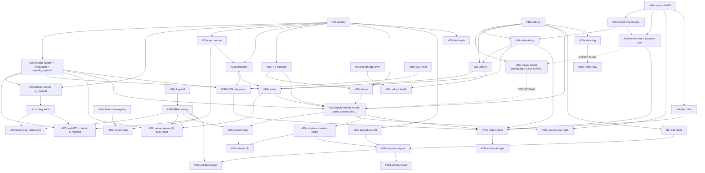
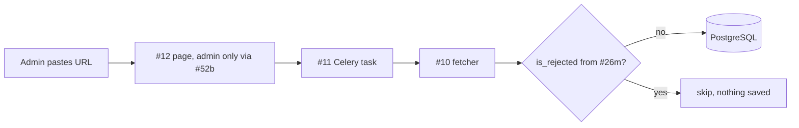
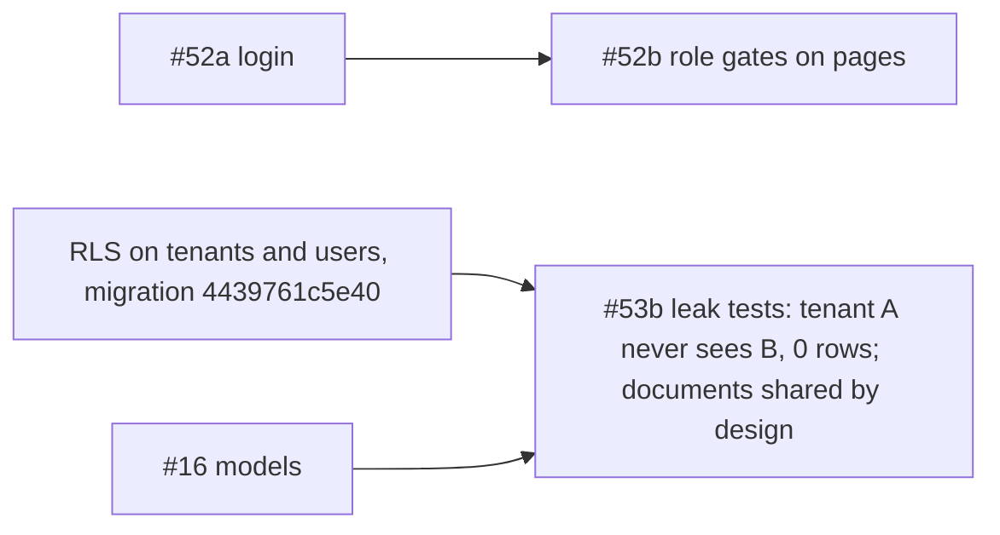
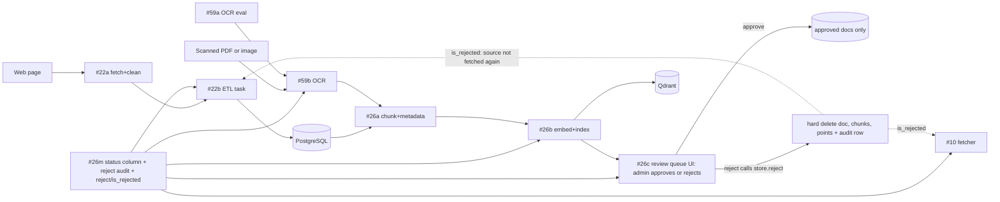
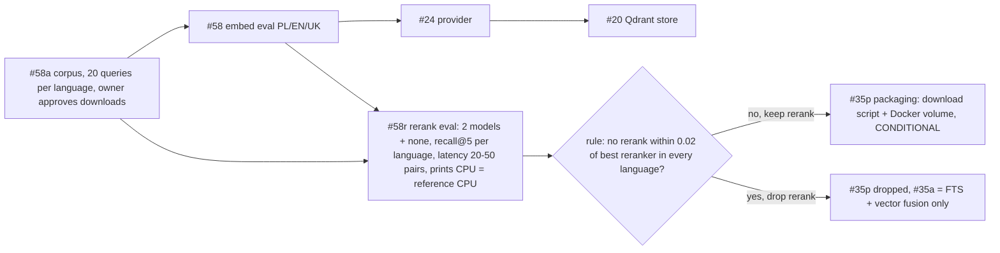
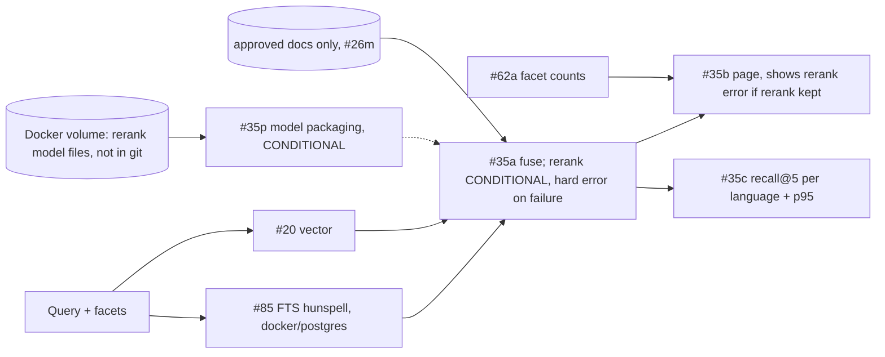
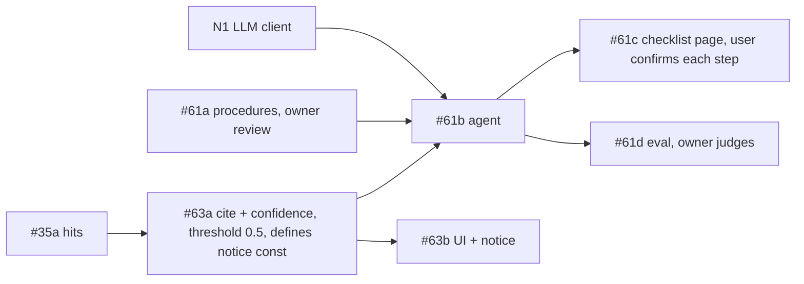
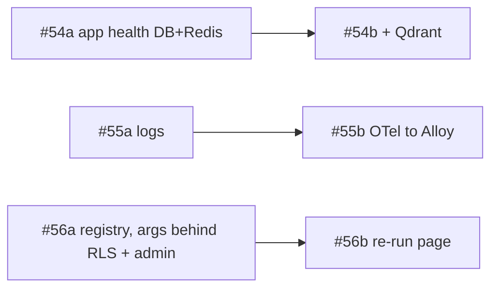
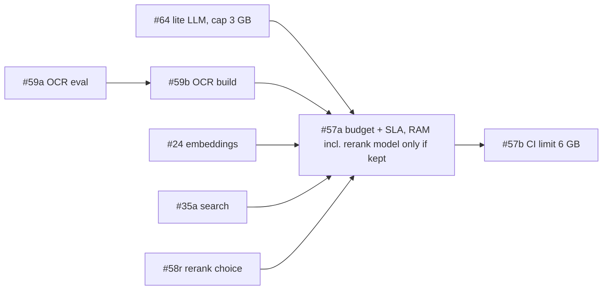

# Wave 1 DAG v6 (2026-11-01)

v6 change: patched with owner decisions (see "Changes from v5"). Reject audit table and `reject`/`is_rejected` store methods live in #26m. Shared fetcher #10 checks `is_rejected`. The `rerank_enabled` setting is removed. Rerank is CONDITIONAL on the #58r outcome rule. Reference CPU is the machine #58r runs on.

Ids: GitHub issue number. Suffix a/b/c/d/p/r/m = split of a big issue or a prerequisite. `N1` = new task (no issue yet).
Agents: py-coder, qa-agent, solution-architect, docs. Quality gate on every code task: ruff check, ruff format --check, pyright, `.venv/bin/pytest -m "not integration"`.
Import style is bare (setuptools `where=["src"]`): `from config.settings import ...`, `from data.models import ...`. Never `src.` in code or done conditions.
No cycles (every edge goes from a lower layer to a higher layer).
Gates marked GATE need an owner decision or approval before work starts or before merge.
RLS facts: migration 4439761c5e40 enables RLS only on `tenants` and `users`. `legal_document` has no RLS by design (ADR-0003: documents are shared). It has `metadata` JSONB, nullable `tenant_id`, `is_processed` bool, and (before #26m) no `status` column.
Rule for new tenant-owned tables: the policy is created in the migration of the task that adds the table (for example #56a, #61c). The reject audit table is shared (no RLS), like documents.
Shared constant: `NOT_LEGAL_ADVICE_NOTICE` is defined once in #63a (module `core/notices.py`). #63b, #61b and #61c import it.
UI note: `src/ui/components/auth.py` and all `src/ui/pages/*` modules do not exist yet (only `__init__.py` and `README.md`). Each UI task creates its own module.
Rerank rule: there is no `rerank_enabled` setting. Rerank is part of search. If rerank is kept, a missing or broken model is a hard error with an explicit message. There is no silent fallback and no "reduced ranking" mode.
CONDITIONAL rule (decided in #58r): if no rerank has equal quality, meaning recall@5 within 0.02 of the best reranker for EVERY language (PL, EN, UK), then rerank is dropped. #35p is dropped, and #35a does FTS + vector fusion only. Items flagged CONDITIONAL below exist only if #58r keeps a rerank model.
Reject rule: `reject(document_id, admin)` and `is_rejected(source_url)` are store methods from #26m. Fetch paths (#10, and through it #11 and #12) and #22b call `is_rejected` before saving.

## Task table

| id | title | depends on | done condition | size | agent |
|----|-------|-----------|----------------|------|-------|
| #16 | Data models: move `LegalDocument` etc. to `src/data/models.py`, re-export from postgres.py | - | `pytest tests/unit/test_data_models.py` passes. `from data.models import LegalDocument` works. Existing store tests still pass. | S | py-coder |
| #18 | Full settings in `src/config/settings.py` (plain class reading `os.getenv`, not pydantic): add Qdrant, embedding, LLM, OTel keys (none exist yet), `min_confidence` (default 0.5), rerank keys (`rerank_model_name`, `rerank_model_path`; CONDITIONAL on #58r, removed again if rerank is dropped). There is NO `rerank_enabled` key. REMOVE the Cohere keys `rerank_base_url`, `rerank_api_key`, `rerank_model`. Update both `src/config/.env.example` and `docker/.env.example`. | - | `pytest tests/unit/config/test_settings.py` passes. Every new key has a default or a documented required flag. `grep -ri -e cohere -e rerank_api_key -e rerank_base_url -e rerank_enabled src/config docker/.env.example` gives 0 lines. | S | py-coder |
| #10 | DocumentFetcherAgent (simple, URL to `LegalDocument`). Calls `is_rejected(source_url)` before saving. A URL with an audit row is skipped and no document is stored. | #16, #26m | `pytest tests/unit/test_fetcher_agent.py` passes with mocked HTTP. Test: a `source_url` for which `is_rejected` returns true is skipped and nothing is saved. | S | py-coder |
| #11 | Celery `fetch_document` task (inherits the `is_rejected` skip from #10) | #10 | `pytest tests/unit/test_fetch_task.py` passes (eager mode). Task saves a document via the store. Test: a rejected URL gives no saved document. | S | py-coder |
| #12 | Minimal Streamlit fetch page (new module in `src/ui/pages/`). It writes data, so it is admin only through the #52b role gate. Inherits the reject skip through #10/#11. | #11, #52b | `pytest tests/unit/test_fetch_page.py` (Streamlit `AppTest`) passes: admin sees the submit form, role `user` does not. Manual: admin submits URL in docker stack, document row exists. | S | py-coder |
| #52a | Login UI with streamlit-authenticator (ADR-0013), replace JWT scope of #52. Creates `src/ui/components/auth.py`. | - | `AppTest`: wrong password shows error, right password sets session user. File `src/ui/components/auth.py` exists. | M | py-coder |
| #52b | RBAC wiring: reusable role gate helper. `admin` sees write actions, `user` read-only. Applied to every page that exists at merge. Later page tasks call it. | #52a | `pytest tests/unit/test_ui_rbac.py` passes: user role cannot reach write widgets. | S | py-coder |
| #53b | Tenant leak tests (integration) on the existing RLS policies on `tenants` and `users` (migration 4439761c5e40), plus a reusable helper for any new tenant-owned table. Shared documents (`legal_document`) are not tenant-isolated by design, so the test only asserts the intended sharing. ADR-0003 becomes `accepted` in this task, and its Chroma/Memgraph text is fixed. | #16 | `docker compose --profile test -f docker/docker-compose.yml run --rm test` passes `tests/integration/test_tenant_leak.py`. Test: tenant A cannot read or write tenant B rows in `tenants` and `users`. Count of cross-tenant rows is 0. Test: `legal_document` rows are visible to both tenants (documented as shared). `docs/adr/0003*.md` status is `accepted` and `grep -ci -e chroma -e memgraph` on it gives 0 (or only "superseded" notes). | M | qa-agent |
| #85 | PostgreSQL FTS: NEW `docker/postgres/` (Dockerfile with Polish hunspell dictionary + init script) and a compose change to build it (today there is no Postgres Dockerfile; `docker/Dockerfile` is the app image). Then tsvector column with that text-search config, GIN index, `search_documents` uses `ts_rank`. Fallback is `simple`+`unaccent`, used ONLY with owner approval. GATE: the switch needs owner approval. | #16 | Integration test `tests/integration/test_fts_search.py` passes: an inflected Polish form (for example "dzieci" vs "dziecko") matches. Query plan uses GIN index (`EXPLAIN` assert). Alembic up/down OK. `docker compose -f docker/docker-compose.yml build postgres` succeeds and the dictionary exists in the image. | M | py-coder |
| #58a | GATE: fetch and prepare the sample corpus: about 50 public Polish law texts (family, child care, tax, residence) plus a query set of 20 queries per language (Polish, English, Ukrainian; 60 in total) with expected articles. Every download needs owner approval. | - | Owner approved the source list in writing. `data/eval/corpus/` holds about 50 texts with source URL and licence note. `data/eval/queries.jsonl` has exactly 20 queries for each of Polish, English and Ukrainian, with expected doc ids. `pytest tests/unit/test_eval_corpus.py` passes (file count, schema, 3 languages x 20 queries). | S | docs |
| #58 | Embedding eval (embedding only) for Polish, English, Ukrainian (harness + report, pick model) | #58a | `scripts/eval_embeddings.py` runs on the #58a corpus and writes `docs/evals/embedding-multilang.md` with recall@5 per language and RAM per model. One model is named as chosen. Chosen model has recall@5 >= 0.80 in each language. | M | qa-agent |
| #58r | Rerank eval: compare BAAI/bge-reranker-v2-m3 (int8 ONNX), Horizon-Labs/multilingual-reranker-small (int8 ONNX) and no rerank. Candidates come from first-stage retrieval with the model chosen in #58. The script prints the CPU model of the host. That host is the reference CPU for the 500 ms limit. ADR-0009 (evals, proposed) becomes `accepted` here, after #58 and #58r both produced reports. Outcome rule: if for EVERY language (PL, EN, UK) the recall@5 of no rerank is within 0.02 of the best reranker, the choice is "no rerank", rerank and #35p are dropped, and #35a does FTS + vector fusion only. Otherwise the best reranker under the latency limit is chosen. | #58a, #58 | `scripts/eval_rerank.py` runs on the #58a corpus and writes `docs/evals/rerank.md` with recall@5 per language (PL, EN, UK) and latency for 20-50 pairs on CPU, for all three options. The report prints the CPU model of the host and states it is the reference CPU. The report states the outcome rule and the per-language gap (best reranker minus no rerank) in recall@5. One option is named as chosen (a model, or "no rerank" by the rule). A chosen model has latency < 500 ms for 20-50 pairs and does not lower recall@5 against no rerank. RAM of each model is listed. `docs/adr/0009*.md` status is `accepted`. | M | qa-agent |
| #24 | Embedding provider (direct integration, chosen model) | #58, #18 | `pytest tests/unit/test_embedding_provider.py` passes. Vector size equals the model dimension. Peak RAM is noted in the test log. | M | py-coder |
| #20 | Qdrant integration: add `qdrant-client` to `pyproject.toml` dependencies, compose service, client, upsert/search/delete-by-document with `tenant`/facet payload filters | #24, #18 | `grep -n qdrant-client pyproject.toml` gives 1 line and `.venv/bin/python -c "import qdrant_client"` works. Integration test `tests/integration/test_qdrant_store.py` passes: upsert 10 vectors, search returns the nearest, payload filter works, delete by document id removes its points. | M | py-coder |
| #22a | Web source fetcher (httpx, robots.txt, rate limit, HTML to text) | #16 | `pytest tests/unit/test_web_source.py` passes with recorded HTML fixtures. | M | py-coder |
| #22b | Web ETL Celery task (fetch, normalise, store, content hash + version stub only; full Git diffs wait for #28). Calls `is_rejected(source_url)` and skips audited URLs. | #22a, #11, #26m | Integration test: task run stores a document with `source_url` and a content hash. Re-run with same content makes no new version. Test: a `source_url` that `is_rejected` reports (audit row from a reject) is not fetched and no document is stored. | M | py-coder |
| #26m | NEW. Alembic migration adding `status` to `legal_document` (values `needs_review`, `approved` only; default `needs_review` for new rows; existing rows set to `approved`), plus a reject audit table (document id, source URL, admin, time; no RLS, documents are shared), plus the model fields in `data.models`. Adds store methods `reject(document_id, admin)` (one transaction: hard delete of the document and its chunks, one audit row; the Qdrant points are removed through a delete hook that #26c wires to #20) and `is_rejected(source_url)` (true if an audit row has that URL). | #16 | `alembic upgrade head` then `alembic downgrade -1` both succeed. `pytest tests/integration/test_document_status.py` passes: a new row without status gets `needs_review`, a row that existed before the migration reads `approved` (backfill), and a value outside the two (including `rejected`) is rejected. The audit table exists with the four columns. `pytest tests/integration/test_reject_store.py` passes: `reject` removes the document row and its chunks (count 0), writes one audit row with document id, source URL, admin and time, and calls the delete hook once. `is_rejected` is true for that URL and false for another. | M | py-coder |
| #26a | DocumentProcessorAgent part 1: chunking + metadata (area, jurisdiction, doc type, date) | #16, #22a | `pytest tests/unit/test_processor_chunking.py` passes. Chunks keep offsets and `source_url`. | M | py-coder |
| #26b | DocumentProcessorAgent part 2: embed chunks + index in Qdrant, status `needs_review` until approved (uses the #26m column) | #26a, #26m, #24, #20 | Integration test: processing one document gives N points in Qdrant and `status=needs_review`. A store call `approve(doc_id)` sets `approved` and updates the point payload. | M | py-coder |
| #26c | Review queue page (new module in `src/ui/pages/`): admin lists `needs_review` documents (text, source, scan or text origin), approves or rejects. It only provides the UI and calls the store `reject` from #26m, with the Qdrant delete hook wired to #20. There is no `rejected` status. | #26b, #26m, #52b | `AppTest`: admin approves a document, status becomes `approved`. Integration test: admin rejects a document through the page, then the document row, its chunks and its Qdrant points are gone (count 0) and one audit row exists with document id, source URL, admin and time. Role `user` sees no queue, no approve button and no reject button. | M | py-coder |
| #59a | OCR eval (Polish scans): pick engine | - | `docs/evals/ocr-pl.md` lists CER and RAM per engine. One engine is chosen. | M | qa-agent |
| #59b | OCR integration in DocumentProcessorAgent for scanned PDFs and images, with the engine chosen in #59a. Output enters the same chunk and review path and sets `status` (uses the #26m column). | #59a, #26a, #26m | `pytest tests/unit/test_processor_ocr.py` passes on a scanned PDF fixture and a PNG fixture: text is extracted, chunks keep `source_url`, `status` is `needs_review`. CER on the fixture is below the #59a threshold. | M | py-coder |
| #62a | Faceted filters in store: facet counts + filter params (area, jurisdiction, type, date) | #85, #16 | `pytest tests/integration/test_facets.py` passes: counts match rows, filters combine with AND. | M | py-coder |
| #35p | CONDITIONAL on #58r (dropped if the outcome rule says "no rerank"). NEW. Rerank model packaging: `scripts/fetch_rerank_model.py` downloads the model named in `docs/evals/rerank.md` into `rerank_model_path`. Compose adds a named Docker volume mounted at that path. Model files stay out of git. GATE: the owner approves the download. | #18, #58r | `pytest tests/unit/test_fetch_rerank_model.py` passes with a mocked download (files land in the target dir, a second run changes nothing). `git ls-files` lists no model file (`git ls-files \| grep -ci -e onnx -e safetensors` gives 0). `docker compose -f docker/docker-compose.yml config` shows a named volume mounted at `rerank_model_path`. Owner approval of the download is recorded in the PR. | S | py-coder |
| #35a | Hybrid search service: FTS + vector, fused, filters. Rerank part CONDITIONAL on #58r: local cross-encoder rerank with the model named in `docs/evals/rerank.md` (primary BAAI/bge-reranker-v2-m3 int8 ONNX, fallback Horizon-Labs/multilingual-reranker-small int8 ONNX), model files from #35p. If #58r says "no rerank", the service does FTS + vector fusion only and the rerank tests are not written. Searches `approved` documents only (column from #26m). There is no `rerank_enabled` setting. With rerank kept, failure is a HARD ERROR: model missing or load fails raises an explicit error (named exception with a clear message), no silent fallback. A slow rerank call is not a failure. | #85, #62a, #26b, #26m, #18, #35p (CONDITIONAL edge) | `pytest tests/integration/test_hybrid_search.py` passes. A known query returns the expected doc in top 3. A `needs_review` document never appears. CONDITIONAL (rerank kept): with the model files missing, the service raises the explicit rerank error and returns no results. With a model that fails to load (corrupt file), the same error is raised. A mocked slow rerank call still returns reranked results (no error, no fallback). Perf test `test_rerank_latency.py` (rerank kept only): 20-50 pairs rerank in < 500 ms on the reference CPU (the #58r host, CPU model printed in `docs/evals/rerank.md`). In CI the limit is looser, 1000 ms (2x). | M | py-coder |
| #35b | Streamlit search page with facet sidebar (new module in `src/ui/pages/`). CONDITIONAL part (rerank kept): shows the rerank error to the user when #35a raises it. | #35a, #52b | `AppTest` search page test passes: filter changes the result list. CONDITIONAL (rerank kept): with the rerank error mocked, the page shows the error message and no result list. Without the error, no error text is shown. | M | py-coder |
| #35c | Hybrid search eval and latency (rerank as chosen in #58r): recall@5 per language, p95 latency | #35a, #58a | `scripts/eval_search.py` writes `docs/evals/search.md`. recall@5 >= 0.80 for Polish, English and Ukrainian. A Ukrainian question returns the expected Polish article in the top 5. p95 hybrid search latency < 3 s. | M | qa-agent |
| #63a | Citations with confidence: citation model, score from retrieval (+ rerank score if rerank is kept), source link. If confidence < `min_confidence` (start 0.5) or no citation, the result is "no reliable answer" plus the closest sources. A rerank error from #35a (if rerank is kept) is not caught here. Defines `NOT_LEGAL_ADVICE_NOTICE` once in `core/notices.py`. ADR-0008 becomes `accepted` in this task. | #35a | `pytest tests/unit/test_citations.py` passes: every answer chunk has `source_url`, `confidence` in [0,1]. Test: confidence 0.4 with default setting gives "no reliable answer" and the closest sources. Test: no citation gives the same. Test: changing `min_confidence` changes the outcome. `from core.notices import NOT_LEGAL_ADVICE_NOTICE` works and `grep -rn "NOT_LEGAL_ADVICE_NOTICE =" src` gives exactly 1 line. `docs/adr/0008*.md` status is `accepted`. | M | py-coder |
| #63b | Render citations in UI (score, link, quote). Every answer view shows `NOT_LEGAL_ADVICE_NOTICE` (imported, not retyped). | #63a, #35b | `AppTest`: result view shows link and score for each hit. `AppTest`: the answer view contains the exact `NOT_LEGAL_ADVICE_NOTICE` text (with citations, and with "no reliable answer"). A view without the notice fails the test. | S | py-coder |
| N1 | OpenAI-compatible LLM client (per-agent config, timeout, local model) | #18 | `pytest tests/unit/test_llm_client.py` passes with a mock server. Config selects model per agent name. | S | py-coder |
| #61a | Bureaucracy knowledge base: procedure schema + seed 3 procedures (PESEL, residence card, tax ID). Each step has a source link, a last-checked date and a "verify with the office" line. GATE: owner reviews every source and step before merge. | #16 | `scripts/seed_db.py` loads 3 procedures. `pytest tests/unit/test_procedures_schema.py` passes: every step has non-empty `source_url`, `last_checked` date and the "verify with the office" line. Owner review is recorded as an approving PR review. | M | docs |
| #61b | Bureaucracy assistant agent: retrieve procedure, build checklist, cite sources, ask user to confirm each step (HITL). Output carries `NOT_LEGAL_ADVICE_NOTICE` from `core.notices`. | #61a, #63a, N1 | `pytest tests/unit/test_bureaucracy_agent.py` passes with mock LLM: output has ordered steps, each with a citation, source link, last-checked date and a `needs_confirmation` state. Output includes the imported notice constant. | M | py-coder |
| #61c | Bureaucracy assistant Streamlit page (new module in `src/ui/pages/`; checklist, progress per tenant user). Shows `NOT_LEGAL_ADVICE_NOTICE`. New progress table gets its RLS policy in its own migration. | #61b, #52b | `AppTest` passes: user ticks a step, state is saved for that tenant only. Page contains the notice text from `core.notices`. Each step shows link, last-checked date and the office line. Leak test case for the new table passes. | M | py-coder |
| #61d | Bureaucracy assistant eval: at least 10 questions, check steps and citations. GATE: the owner judges correctness. | #61b | `scripts/eval_bureaucracy.py` writes a report with at least 10 questions. 100% of answers have an openable source link (HTTP 200 check). At least 90% are judged correct by the owner (judgement column filled by the owner). The report suggests a tuned `min_confidence`. | S | qa-agent |
| #54a | Health checks, app level only (compose already has healthchecks for postgres, redis, app, worker): app `/health` that checks DB and Redis. ADR-0010 (health checks, proposed) becomes `accepted` here. | - | `pytest tests/unit/test_health.py` passes: `/health` returns ok with DB and Redis up, and reports `db: down` or `redis: down` when a mock fails. `docker compose -f docker/docker-compose.yml ps` still shows `healthy` for all services. `docs/adr/0010*.md` status is `accepted`. | S | py-coder |
| #54b | Add Qdrant check to health | #54a, #20 | Stop Qdrant, health reports `qdrant: down`. Test `tests/integration/test_health_qdrant.py` passes. | S | py-coder |
| #55a | structlog JSON logging with request/task ids and PII scrub | #18 | `pytest tests/unit/test_logging.py` passes: log line is JSON, email is masked. | S | py-coder |
| #55b | OTel traces/metrics to Grafana Alloy (compose service + config). ADR-0005 becomes `accepted` in this task. | #55a | Compose with Alloy starts. A test span shows in the Alloy debug exporter log. `docs/adr/0005*.md` status is `accepted`. | M | py-coder |
| #56a | Failed-task registry: table (with RLS policy), migration, Celery `task_failure` handler, retry policy. Task args are stored in the table and are readable only behind RLS and the admin role. ADR-0006 becomes `accepted` in this task. | - | Integration test: forced failing task writes a row with traceback and args. Alembic up/down OK. Policy exists for the new table (`pg_policies`). Test: tenant B cannot read the row of tenant A, and role `user` cannot read the args (the admin-gated read method refuses). `docs/adr/0006*.md` status is `accepted`. | M | py-coder |
| #56b | Failed-task page with re-run button (admin only; new module in `src/ui/pages/`) | #56a, #52b | `AppTest`: admin clicks re-run, task is re-queued, row status changes. User role does not see the button. | M | py-coder |
| #64 | Target lite LLMs: benchmark 2-3 small models on RAM, tokens/s, answer quality in Polish, English, Ukrainian. The LLM is capped at 3 GB RAM. | #58a | `docs/evals/lite-llm.md` lists RAM and tokens/s per model on a 4-6 GB limit, and answer quality per language. One model is chosen. Peak RAM of the chosen model is <= 3 GB. | M | solution-architect |
| #57a | Efficiency budget + SLA doc and measurement script. RAM measure includes the rerank model only if rerank is kept (CONDITIONAL on #58r). ADR-0011 becomes `accepted` in this task. | #64, #59b, #24, #35a, #58r | `scripts/measure_budget.py` runs the stack (including OCR and search) under `mem_limit: 6g` and prints RAM per service (the LLM is a separate line; if rerank is kept, the rerank model is a separate line and is loaded) and p95 search latency. Peak RAM <= 6 GB, LLM <= 3 GB. p95 hybrid search < 3 s. `docs/` budget table filled. `docs/adr/0011*.md` status is `accepted`. | M | solution-architect |
| #57b | Enforce budget in CI/compose (`mem_limit: 6g`, smoke check) | #57a | Compose `test` profile fails if peak RAM > 6 GB. The CI job is green. | S | py-coder |

Total: 43 tasks (same as v5; no task added or removed). 15 S and 28 M (#26m grew from S to M).

## Changes from v5
- Reject audit: the audit table stays in #26m (same migration as `status`). #26m now also adds the store methods `reject(document_id, admin)` (hard delete of document and chunks, plus audit row; Qdrant points removed by a delete hook) and `is_rejected(source_url)`. Size S to M. New done test `test_reject_store.py`.
- #26c only provides the admin UI and calls `reject`; it wires the Qdrant delete hook to #20. Its integration test still checks document, chunks, points and audit row.
- New edge #26m -> #10. #10 calls `is_rejected` before saving and skips audited URLs. #11 and #12 inherit it through #10 (tests added in #10 and #11). #22b also calls `is_rejected` (edge #26m -> #22b kept). The old note that only #22b checks the audit table is removed.
- Effect of the new edge: #10 no longer starts on day 1 after #16. #10 waits for #26m. Chain #16 -> #26m -> #10 -> #11 -> #12 (and #22b) is 5 steps. It stays shorter than the critical path.
- `rerank_enabled` removed from #18 (key, default and test) and from #35a. The #18 grep check now also rejects `rerank_enabled`. Rerank is part of search.
- #58r outcome rule: if recall@5 of no rerank is within 0.02 of the best reranker for every language, rerank and #35p are dropped and #35a does FTS + vector fusion only. #35p and the rerank parts of #35a, #35b, #57a (also the rerank keys in #18, the rerank case in #63a, the rerank wording in #35c) are flagged CONDITIONAL on #58r. They stay in the table.
- Reference CPU for the 500 ms limit is the machine #58r runs on. The report prints the CPU model. CI uses a limit of 1000 ms (2x) in #35a.
- #20 gets a delete-by-document function and a test, so the reject hook has a target.

## Whole DAG

## Cluster diagrams (intent)

### 1. Minimal example (#10-#12, #13 done)

### 2. Auth and tenant safety (#52, #53)

### 3. Ingestion, OCR and review (#22, #26, #59)

### 4. Embeddings, rerank eval and vectors (#58a, #58, #58r, #24, #20)

### 5. Search (#85, #62, #35)

### 6. Citations and bureaucracy assistant (#63, #61)

### 7. Ops track (#54, #55, #56)

### 8. Budget (#64, #59, #57)

## Critical path (9 steps)
#58a -> #58 -> #24 -> #20 -> #26b -> #35a -> #63a -> #61b -> #61c
#58r (after #58) and #35p (after #58r, CONDITIONAL) run beside #24, #20 and #26b and join at #35a. They add no step.
#26m (after #16) is short and joins at #26b. It adds no step.
#16 -> #26m -> #10 -> #11 -> #12 (and #22b) is a 5-step chain. It stays off the critical path. #52a -> #52b -> #12 is also short.
Near-equal path: #16 -> #22a -> #26a -> #26b -> #35a -> #63a -> #61b -> #61c.
Longest tail after #35a: #35a -> #57a -> #57b (needs #64, #59b and #58r first).

## Parallel from day 1 (no dependencies)
#16, #18, #52a, #54a, #58a (GATE), #56a, #59a.
(#10 now waits for #16 and #26m. #26m, #22a, #53b, #85, #61a wait for #16 only. #64 waits for #58a. #58r waits for #58. #35p waits for #18 and #58r. #12 waits for #11 and #52b.)

## Schedule (ESTIMATE, not a commitment)

Assumptions: S = 1.5 agent-days, M = 3 agent-days, including owner review turnaround. Planning date 2027-02-28. Today 2026-11-01 gives about 17 weeks.
- Total effort: 15 x 1.5 + 28 x 3 = 22.5 + 84 = about 107 agent-days (if rerank is dropped, #35p is removed: about 105).
- Critical path: 1.5 + 8 x 3 = about 26 days, about 5-6 weeks if nothing waits.
- One serial stream needs about 21 weeks. That misses the date. Two or three parallel streams need about 8-11 weeks of work.
- Verdict: feasible if at least 2 streams run in parallel and owner gates answer within 2-3 days. The slack is about 5-6 weeks. Holidays, hunspell image build trouble, eval retries and OCR tuning can use most of it. Risk is medium.
- Gates that can stall the plan: #58a corpus approval, #58r model choice, rerank model download approval (#35p, only if rerank is kept), #85 fallback decision, #61a source review, #61d owner judging, all seven ADR acceptances (0003, 0005, 0006, 0008, 0009, 0010, 0011).

Rough weekly plan by layer:

| Weeks | Layer | Tasks |
|-------|-------|-------|
| 1-2 | L0 no dependencies | #16, #18, #52a, #54a, #56a, #58a (owner approves downloads), #59a |
| 2-4 | L1 | #26m, #52b, #22a, #85, #58, #64, N1, #55a, #61a (owner review), #53b |
| 4-8 | L2 | #10, #24, #58r, #20, #26a, #62a, #56b, #54b, #55b, #59b |
| 5-9 | L3 | #11, #12, #22b, #35p (CONDITIONAL), #26b, #26c, #35a, #35b |
| 10-13 | L4 | #63a, #63b, #35c, #61b, #61c, #61d (owner judging) |
| 13-15 | L5 | #57a, #57b, tuning of `min_confidence`, fixes from evals |
| 16-17 | Buffer | Holidays, overrun, final owner review of ADRs and procedures |

If the check at week 8 shows #35a not started, the orchestrator reports a new date. Scope stays, the date moves.

## Flags and open questions
1. OPEN: #26m `reject` also has to remove Qdrant points, but #26m depends only on #16 (Qdrant comes from #20 much later). v6 keeps the dependency light: `reject` deletes DB rows and calls a delete hook, and #26c wires the hook to #20. The owner confirms this, or accepts that #26m (and so #10) waits for #20.
2. OPEN: the "chunks" table does not exist yet (chunks come from #26a). Until then `reject` deletes only the document row. The owner confirms that #26m may add the chunk delete as soon as #26a defines the chunk storage (or that #26a owns the chunk cascade).
3. OPEN: #58r tie case. If "no rerank" wins by the 0.02 rule, the rerank keys in #18 are removed, and the CONDITIONAL parts are not built. The owner confirms that the 0.02 margin is on recall@5 per language, as written.
4. OPEN: CI latency limit is set to 1000 ms (2x the 500 ms reference limit). The owner confirms the factor.
5. #85 hunspell: dictionary adds image work (new `docker/postgres/` and compose change). Fallback `simple`+`unaccent` only with owner approval.
6. #58a: the source list and licence of each text need owner approval before download. The #35p model download needs owner approval too (if rerank is kept).
7. #52 issue text still says JWT. The issue needs a rewrite to ADR-0013.
8. #61a/#61d: owner is the only reviewer and judge. A lawyer review comes before v1.
9. Size check: #26b is the largest M task. #26m is now M.
10. #58r depends on #58 (it needs the chosen embedding for candidates). If the owner accepts a baseline retriever, #58r can start after #58a only.
11. Wave 1 test count: the CLAUDE.md numbers (54/67 tests) will grow. No impact on the DAG.
12. Closed by the owner in v6: reject audit and methods in #26m, `is_rejected` in #10/#11/#12/#22b, `rerank_enabled` removed, rerank CONDITIONAL on the #58r rule, reference CPU = #58r host. Closed earlier: ADR map, #22b stub, #26m backfill `approved`, #12 admin only, rerank failure behavior, `qdrant-client`, 20 queries per language, LLM cap 3 GB, #56a args behind RLS and admin.

## Later (Wave 2 candidates, not in Wave 1)

- Cloudflare Clef-flash as an answerability check for #63a (decide if the retrieved sources answer the question). It needs a GPU or more RAM than the 4-6 GB budget. Idea only. No task, no dependency, no effort counted. Revisit after #57a shows the real RAM headroom.
- #28 full Git diffs for #22b (already in requirements).
