# Wave 1 tickets: models, settings, fetch, web ETL, evals, embeddings, Qdrant, FTS

Common quality gate (every code ticket): `.venv/bin/ruff check`, `.venv/bin/ruff format --check`, `.venv/bin/pyright`, `.venv/bin/pytest -m "not integration"`.
Path note: repo code uses bare imports (`from config.settings import get_settings`, `from data.models import LegalDocument`). Setuptools uses `where=["src"]`, so never write a `src.` prefix. Files marked (new) do not exist yet. Files marked (verify) have a guessed path.

---
## W1-16 Data models to `src/data/models.py`
**Context:** `LegalDocument` lives in the PostgreSQL store file. Agents and ETL need it without importing the store.
**Scope:** Move `LegalDocument` (and `Base` if needed for metadata) to `src/data/models.py`. Re-export from `postgres.py`. **Non-goals:** no schema change, no new migration, no move of `User`/`Tenant`.
**Files:** `src/data/models.py` (new), `src/data/__init__.py` (exists, no change), `src/plugins/relational_db/postgres.py`, `tests/unit/test_data_models.py` (new).
**Depends on:** -. **Blocks:** W1-10, W1-22a, W1-26a, W1-26m, W1-53b, W1-85, W1-61a, W1-62a.
**Acceptance:**
- Given the new module, When I run `from data.models import LegalDocument`, Then it imports with no error.
- Given `postgres.py`, When I import `LegalDocument` from it, Then it is the same object as in `data.models`.
- Given the Alembic metadata, When I run autogenerate, Then it finds 0 schema changes.
- Given the existing store tests, When I run them, Then all pass.
**Test plan:** unit `tests/unit/test_data_models.py` (import, identity, table name `legal_document`). Existing store tests run unchanged.
**Gate:** common gate.
**Before:**
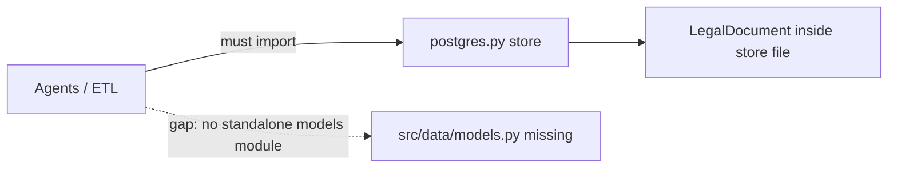
## After
Fill after merge: diagram of what was built.

---
## W1-18 Full settings (Qdrant, embedding, LLM, OTel, min_confidence, rerank model)
**Context:** `Settings` in `src/config/settings.py` is a plain class that reads `os.getenv` (not pydantic). It has the Cohere keys `rerank_base_url`, `rerank_api_key`, `rerank_model`. It has no Qdrant and no OTel keys yet. v3 drops Cohere.
**Scope:** Remove the keys `rerank_base_url`, `rerank_api_key`, `rerank_model`. Add Qdrant (url, api key, collection), OTel (endpoint, service name), `min_confidence` (default 0.5), `rerank_model_name`, `rerank_model_path`. There is no `rerank_enabled` setting (owner decision). A missing rerank model or a load failure is a hard error in the search service. Keep embedding and LLM keys. Update the docstring table and both `.env.example` files. **Non-goals:** no pydantic rewrite unless py-coder shows the DAG needs it (OPEN below), no model choice.
**Files:** `src/config/settings.py`, `src/config/.env.example`, `docker/.env.example` (no root `.env.example` exists), `tests/unit/config/test_settings.py` (exists, extend).
**Depends on:** -. **Blocks:** W1-24, W1-20, W1-N1, W1-54a, W1-55a, W1-35p, W1-35a.
**OPEN:** the DAG says "pydantic settings". The code is not pydantic. Keep the class style and say so in the PR, or get a design decision.
**Acceptance:**
- Given no env vars, When I read `min_confidence`, Then it is 0.5.
- Given the `Settings` class, When I list its attributes, Then there is no `rerank_enabled` attribute and no `RERANK_ENABLED` in either `.env.example`.
- Given the repo, When I run `grep -riE 'cohere|rerank_base_url|rerank_api_key' src/config docker/.env.example`, Then 0 lines.
- Given every new key, When I read it with no env, Then it has a default or a documented required flag.
**Test plan:** unit `tests/unit/config/test_settings.py` with `monkeypatch.setenv`.
**Gate:** common gate.
**Before:**
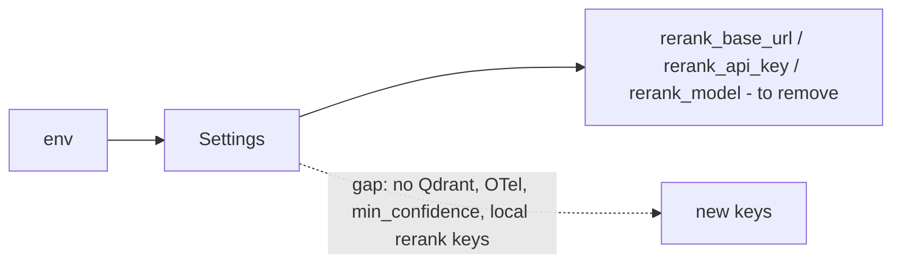
## After
Fill after merge: diagram of what was built.

---
## W1-10 DocumentFetcherAgent (simple)
**Context:** Phase 1 needs a minimal fetch from URL to `LegalDocument`. `src/agents/` has only `__init__.py`.
**Scope:** Class that takes a URL, does an HTTP GET with a timeout, builds a `LegalDocument` (id, title, content, source, source_url, last_updated). Before it fetches, it calls the store method `is_rejected(source_url)` (from W1-26m) and skips audited URLs. W1-11 and W1-12 inherit this check through W1-10. **Non-goals:** no robots.txt, no rate limit, no storage (that is W1-11), no LLM.
**Files:** `src/agents/fetcher.py` (new, verify name), `src/agents/__init__.py` (exists, no change), `tests/unit/test_fetcher_agent.py` (new).
**Depends on:** W1-16, W1-26m. **Blocks:** W1-11.
**Acceptance:**
- Given a mocked 200 response with HTML, When `fetch(url)` runs, Then it returns a `LegalDocument` with `source_url == url` and non-empty `content`.
- Given a mocked 404, When `fetch` runs, Then it raises a clear fetch error and returns no document.
- Given a mocked timeout, When `fetch` runs, Then it raises the same error type within the set timeout.
```gherkin
Scenario: Audited URL is not fetched again
  Given the mocked store `is_rejected(url)` returns true
  When fetch(url) runs
  Then no HTTP request is sent
  And a skip result returns and no document is built
```
**Test plan:** unit, mocked HTTP and mocked store only, no network.
**Gate:** common gate.
**Before:**
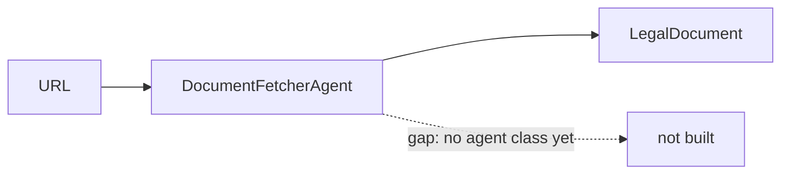
## After
Fill after merge: diagram of what was built.

---
## W1-11 Celery `fetch_document` task
**Context:** The UI must not block on HTTP. A Celery task runs the fetcher and saves the result (ADR-0006).
**Scope:** Task `fetch_document(url, tenant_id)` calls W1-10 and saves through the store. The no re-fetch rule (audited URLs are skipped) is inherited through W1-10, so this task adds no check of its own. **Non-goals:** no failed-task registry (W1-56a), no retry policy tuning.
**Files:** `src/tasks/fetch.py` (new, verify), the Celery app module in `src/tasks/` (register task), `tests/unit/test_fetch_task.py` (new).
**Depends on:** W1-10. **Blocks:** W1-12, W1-22b.
**Acceptance:**
- Given eager mode and a mocked fetcher, When I call the task with a URL, Then the store receives 1 document with that `source_url`.
- Given the fetcher raises, When the task runs, Then the exception reaches the caller and nothing is saved.
- Given the Celery app, When I list tasks, Then `fetch_document` is registered.
- Given W1-10 returns a skip result for an audited URL, When the task runs, Then the store receives 0 documents.
**Test plan:** unit with `task_always_eager`, store mocked.
**Gate:** common gate.
**Before:**
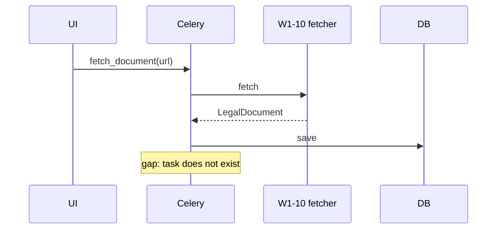
## After
Fill after merge: diagram of what was built.

---
## W1-12 Minimal Streamlit fetch page
**Context:** Users need a page to submit a URL. This closes Phase 1. The page is a write action, so it is admin only (RBAC rule, requirements).
**Scope:** One page with URL input and submit. It queues W1-11 and shows the task state. An audited URL is skipped by W1-10 (inherited, no check in the page). Admin only through the role check from W1-52b. **Non-goals:** no search, no listing page, no styling.
**Files:** `src/ui/pages/fetch.py` (new, verify name; the `src/ui/pages/` modules do not exist yet), `tests/unit/test_fetch_page.py` (new).
**Depends on:** W1-11, W1-52b. **Blocks:** -.
**Acceptance:**
```gherkin
Scenario: Admin submits a URL
  Given an admin session, AppTest and a mocked task
  When I enter a URL and click submit
  Then the task is called once with that URL
Scenario: Empty URL
  Given an admin session
  When I click submit with an empty URL
  Then an error shows and the task is not called
Scenario: User role cannot submit
  Given a session with role "user"
  When the page loads
  Then there is no submit button
  And the task is not called
Scenario: Manual check
  Given the docker stack and an admin session
  When I submit a URL
  Then a legal_document row exists
```
**Test plan:** unit with `streamlit.testing.v1.AppTest` (admin and `user` sessions); manual check in docker.
**Gate:** common gate.
**Before:**
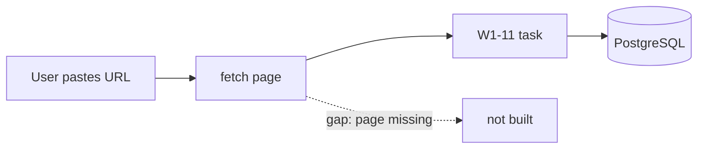
## After
Fill after merge: diagram of what was built.

---
## W1-22a Web source fetcher
**Context:** Production ingest needs polite fetching: robots.txt, rate limit, clean text. W1-10 is only a demo.
**Scope:** httpx client, robots.txt check, per-host rate limit, HTML to clean text, returns title, text, url, fetch date. **Non-goals:** no storage, no hashing (W1-22b), no PDF/OCR (W1-59b).
**Files:** `src/data/sources/web.py` (new, verify), `tests/unit/test_web_source.py` (new), `tests/fixtures/html/` (new).
**Depends on:** W1-16. **Blocks:** W1-22b, W1-26a.
**Acceptance:**
- Given a recorded HTML fixture, When parsed, Then script/style/nav text is absent and the body text is present.
- Given robots.txt disallows the path, When I fetch, Then no page request is sent and a skip result returns.
- Given 2 calls to the same host with limit N s (setting), When timed with a fake clock, Then the gap is >= N s.
- Given Polish text with diacritics, When parsed, Then the characters are unchanged.
**Test plan:** unit with fixtures and `httpx.MockTransport`. No network.
**Gate:** common gate.
**Before:**
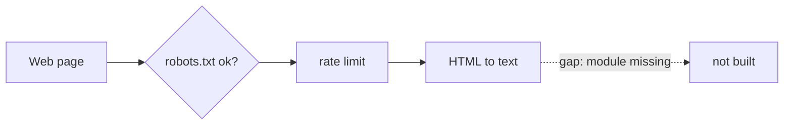
## After
Fill after merge: diagram of what was built.

---
## W1-22b Web ETL Celery task
**Context:** Re-fetching must not create duplicate versions. Full Git diffs wait for W1-28.
**Scope:** Task: fetch (W1-22a), normalise, compute content hash (sha256), store with `source_url`. Same hash means no new version. Versioning is a stub (confirmed default). Before it saves, it calls `is_rejected(source_url)` (from W1-26m) and skips audited URLs. **Non-goals:** no Git-backed diffs, no chunking.
**Files:** `src/tasks/web_etl.py` (new, verify), `src/plugins/relational_db/postgres.py` (hash/version fields, or use the `metadata` JSONB column to avoid a migration), `tests/integration/test_web_etl.py` (new).
**Depends on:** W1-22a, W1-11, W1-26m. **Blocks:** -.
**Acceptance:**
- Given a fixture page, When the task runs, Then 1 document exists with `source_url` and a 64-char content hash.
- Given the same content, When the task runs again, Then the document count stays 1 and the version count stays 1.
- Given changed content, When the task runs, Then a new version is recorded and the hash differs.
```gherkin
Scenario: Audited URL is not fetched again
  Given an audit row for the fixture URL (is_rejected returns true)
  When the task runs
  Then no page request is sent and 0 documents are saved
```
**Test plan:** integration in docker (real PostgreSQL), mocked HTTP.
**Gate:** common gate (integration test runs in the docker `test` profile).
**Before:**
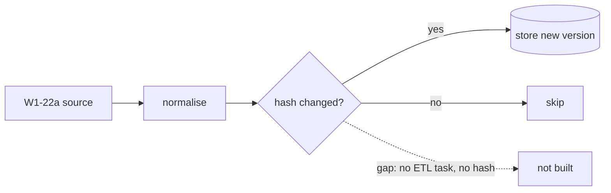
## After
Fill after merge: diagram of what was built.

---
## W1-58a Sample corpus and query set (GATE)
**Context:** Evals W1-58, W1-58r, W1-35c, W1-64 need a shared Polish corpus and PL/EN/UK queries.
**Scope:** About 50 public Polish law texts (family, child care, tax, residence) with source URL and licence note. A query set with expected doc ids, 20 queries per language (confirmed). **Non-goals:** no eval code, no download before the owner approves the list in writing.
**Files:** `data/eval/corpus/*` (new), `data/eval/sources.md` (new, source list for approval), `data/eval/queries.jsonl` (new), `tests/unit/test_eval_corpus.py` (new).
**Depends on:** - (GATE: owner approval). **Blocks:** W1-58, W1-58r, W1-35c, W1-64.
**Acceptance:**
- Given the source list, When the owner approves it in writing, Then downloads may start (not before).
- Given `data/eval/corpus/`, When I count files, Then the count is about 50 (45 to 55) and each has a source URL and licence note.
- Given `queries.jsonl`, When I parse it, Then each row has `lang` in {pl, en, uk}, a query, and expected doc ids that exist in the corpus.
- Given the set, When I count per language, Then each language has exactly 20 queries.
**Test plan:** unit `tests/unit/test_eval_corpus.py` (count, schema, 3 languages, 20 each).
**Gate:** common gate.
**Before:**
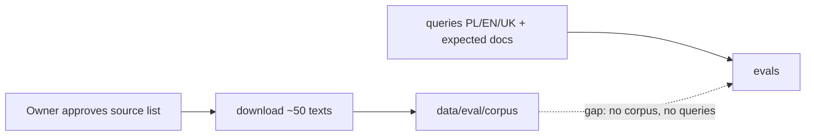
## After
Fill after merge: diagram of what was built.

---
## W1-58 Embedding eval (PL, EN, UK)
**Context:** Eval design: ADR-0009 (`docs/adr/`, status proposed). One embedding model must serve all three query languages on Polish text. Cross-language search is an MVP edge case.
**Scope:** Harness that embeds the W1-58a corpus with 2-3 candidate models, computes recall@5 per query language and RAM per model, writes the report and names one model. **Non-goals:** no rerank (W1-58r), no provider code (W1-24), no Qdrant.
**Files:** `scripts/eval_embeddings.py` (new), `docs/evals/embedding-multilang.md` (new), `tests/unit/test_eval_embeddings.py` (new, metric function only).
**Depends on:** W1-58a. **Blocks:** W1-58r, W1-24.
**Acceptance:**
- Given the W1-58a corpus, When I run the script, Then the report lists recall@5 for pl, en, uk for each model.
- Given the report, When I read it, Then it lists RAM in MB per model.
- Given the report, When I read the verdict, Then exactly 1 model is chosen and its recall@5 is >= 0.80 in each of the 3 languages.
- Given no model reaches 0.80 in each language, When the run ends, Then the report says so and the ticket reports a blocker (no silent pick).
**Test plan:** unit test of the recall@k function with a tiny fixed set. The full run is a manual eval.
**Gate:** common gate.
**Before:**
```mermaid
flowchart LR
  C[W1-58a corpus + queries] --> E[embed with N models] --> R[recall@5 per lang + RAM] --> P[choose 1 model]
  E -. gap: no harness, no choice .-> X[W1-24 blocked]
```
## After
Fill after merge: diagram of what was built.

---
## W1-58r Rerank eval
**Context:** Eval design: ADR-0009 (`docs/adr/`, status proposed). v3 uses a local reranker. The model must be chosen by data before it enters code.
**Scope:** Compare BAAI/bge-reranker-v2-m3 (int8 ONNX), Horizon-Labs/multilingual-reranker-small (int8 ONNX) and no rerank. Candidates come from first-stage retrieval with the W1-58 model. **Non-goals:** no search service (W1-35a), no model files in git. Model download needs owner approval.
**Files:** `scripts/eval_rerank.py` (new), `docs/evals/rerank.md` (new), `tests/unit/test_eval_rerank.py` (new, metric/timing helper).
**Depends on:** W1-58a, W1-58. **Blocks:** W1-35p (CONDITIONAL), W1-35a (rerank parts CONDITIONAL), W1-57a (rerank parts CONDITIONAL).
**Outcome rule (owner decision):** if no rerank is within 0.02 recall@5 of the best reranker for every language (pl, en, uk), rerank is not worth its cost. Then rerank and W1-35p are dropped and W1-35a does FTS + vector fusion only. Otherwise the best reranker that meets the limits below is chosen. W1-35p and the rerank parts of W1-35a, W1-35b and W1-57a are CONDITIONAL on this verdict.
**Reference CPU rule (owner decision):** the 500 ms limit applies on the machine that runs this eval. The report prints the CPU model. CI uses a limit of 2x (1000 ms).
**Acceptance:**
- Given the W1-58a corpus, When I run the script, Then the report has recall@5 for pl, en, uk for all 3 options.
- Given 20 and 50 pairs, When timed on CPU, Then the report lists latency per option and the CPU model.
- Given the report, When I read the verdict, Then 1 option is named. A chosen model has latency < 500 ms for 20-50 pairs and recall@5 not lower than no rerank.
- Given the report, When I read it, Then it lists RAM per model.
- Given no model meets both limits, Then the verdict is "no rerank".
- Given no rerank is within 0.02 recall@5 of the best reranker for every language, Then the verdict is "no rerank". The report states that W1-35p is dropped and W1-35a does FTS + vector fusion only.
- Given the report, When I read it, Then it prints the CPU model and states the CI limit of 2x (1000 ms).
**Test plan:** unit for helpers (including the 0.02 outcome rule). Full run is manual (needs model download after approval).
**Gate:** common gate.
**Before:**
```mermaid
flowchart LR
  R1[retrieval top-N, model from W1-58] --> A[bge-reranker-v2-m3] & B[multilingual-reranker-small] & C[no rerank]
  A & B & C --> M[recall@5 per lang + latency + RAM] --> V[named choice in docs/evals/rerank.md]
  M -. gap: no script, no choice .-> X[W1-35p / W1-35a blocked]
```
## After
Fill after merge: diagram of what was built.

---
## W1-24 Embedding provider (direct integration)
**Context:** `Settings` has `EMBEDDING_BASE_URL` etc. (OpenAI-compatible). No provider code exists. Needed by W1-20 and W1-26b.
**Scope:** Provider class: `embed(texts) -> list[list[float]]` for the model chosen in W1-58, batching, timeout, exposes `dimension`. **Non-goals:** no Qdrant, no chunking, no model switching at runtime.
**Files:** `src/core/embeddings.py` (new, verify; ADR-0014 style direct integration, no plugin), `tests/unit/test_embedding_provider.py` (new).
**Depends on:** W1-58, W1-18. **Blocks:** W1-20, W1-26b, W1-57a.
**Acceptance:**
- Given a mock server returning vectors, When I embed 3 texts, Then I get 3 vectors, each of length equal to the chosen model dimension (value from W1-58 report).
- Given 100 texts and batch size B, When I embed, Then calls = ceil(100/B).
- Given the server times out, When I embed, Then a clear error is raised.
- Given the test run, Then peak RAM is written to the test log.
**Test plan:** unit with mock server; RAM via `resource`/`tracemalloc` printed in log.
**Gate:** common gate.
**Before:**
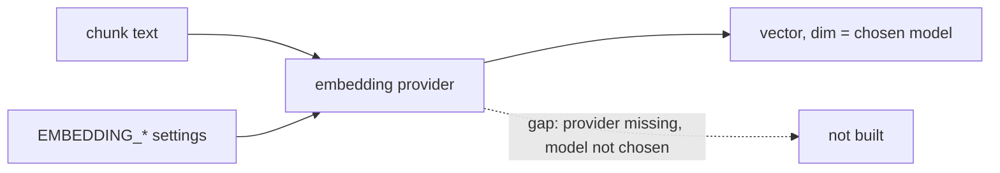
## After
Fill after merge: diagram of what was built.

---
## W1-20 Qdrant integration
**Context:** Vector search is planned (charter) but no Qdrant exists. Tenant and facet filters must work at query time.
**Scope:** Compose service `qdrant`, client wrapper (`ensure_collection`, `upsert`, `search`, payload filter on `tenant`, area, jurisdiction, type, status). Add `qdrant-client` to `pyproject.toml` (owner approved, no separate approval needed). **Non-goals:** no chunking (W1-26), no health check (W1-54b), no rerank.
**Files:** `docker/docker-compose.yml`, `src/storage/qdrant.py` (new, verify), `pyproject.toml` (add `qdrant-client`), `tests/integration/test_qdrant_store.py` (new).
**Depends on:** W1-24, W1-18. **Blocks:** W1-26b, W1-54b.
**Acceptance:**
- Given a Qdrant service, When I upsert 10 vectors, Then a count query returns 10.
- Given a query vector equal to vector 3, When I search top 1, Then the result is point 3.
- Given payloads with tenant A and tenant B, When I search with filter tenant=A, Then 0 results have tenant B.
- Given a facet filter (area=tax), When I search, Then all results have area=tax.
- Given the collection exists, When `ensure_collection` runs again, Then no error and no data loss.
**Test plan:** integration in docker `test` profile (needs Qdrant service in compose).
**Gate:** common gate.
**Before:**
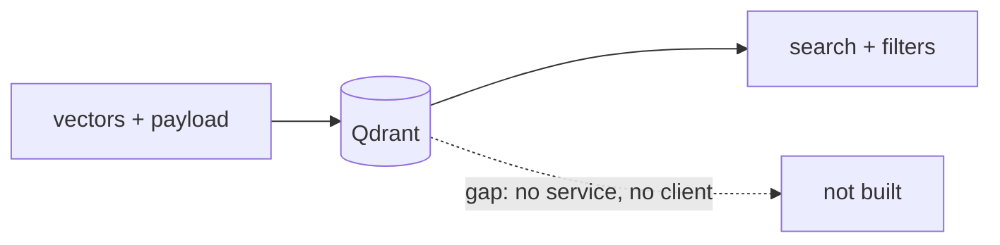
## After
Fill after merge: diagram of what was built.

---
## W1-85 PostgreSQL FTS with Polish hunspell
**Context:** No Postgres image file exists. `docker/Dockerfile` is the app image, and compose uses a stock Postgres image. Polish is highly inflected. Plain FTS misses "dzieci" vs "dziecko". Needed for hybrid search.
**Scope:** Create `docker/postgres/` (a Dockerfile with the Polish hunspell dictionary, plus an init script). Change the `postgres` service in `docker/docker-compose.yml` to build from it. Add a text-search config using the dictionary, a tsvector column on `legal_document`, a GIN index, and `ts_rank` in `search_documents`. Alembic migration with down. **Non-goals:** no facets (W1-62a), no vector search. GATE: use the fallback `simple`+`unaccent` only with explicit owner approval (confirmed).
**Files:** `docker/postgres/Dockerfile` (new), `docker/postgres/init/` (new), `docker/docker-compose.yml` (change postgres service), `migrations/versions/<new>.py` (new), `src/plugins/relational_db/postgres.py`, `tests/integration/test_fts_search.py` (new).
**Depends on:** W1-16. **Blocks:** W1-62a, W1-35a.
**Acceptance:**
- Given the built image, When I run `SELECT to_tsvector('<polish cfg>','dzieci')`, Then it equals the vector for "dziecko" (same lexeme).
- Given a document with "dziecko", When I search "dzieci", Then it is in the results ranked by `ts_rank`.
- Given a search query, When I run `EXPLAIN`, Then the plan uses the GIN index (on a seeded table; set `enable_seqscan=off` if rows are few).
- Given the migration, When I run upgrade then downgrade then upgrade, Then all 3 succeed.
- Given the dictionary cannot be built, Then the ticket stops and asks the owner before the fallback.
**Test plan:** integration `tests/integration/test_fts_search.py`; docker image build check.
**Gate:** common gate.
**Before:**
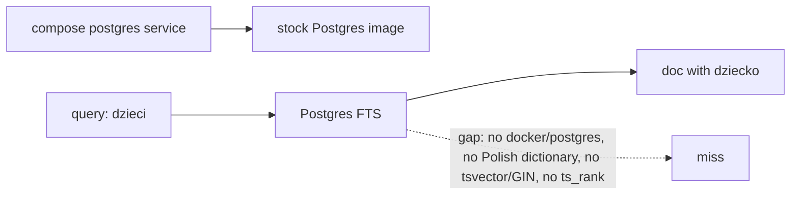
## After
Fill after merge: diagram of what was built.
