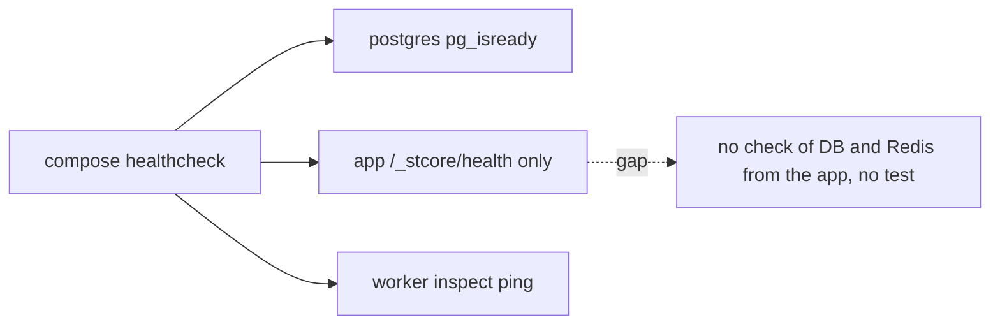
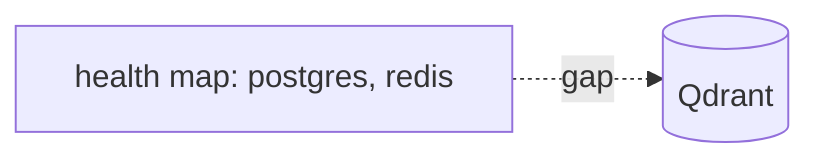
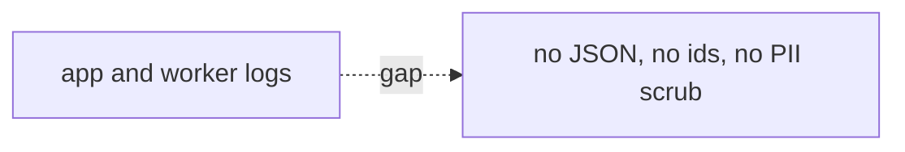
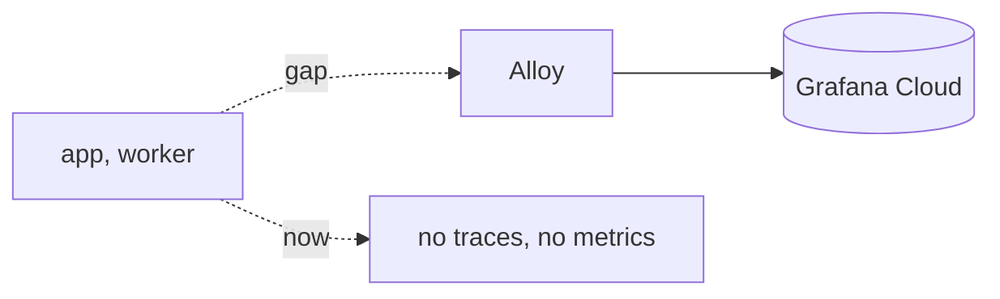
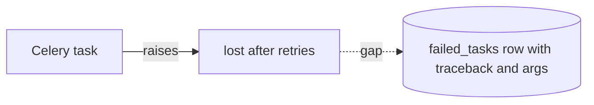
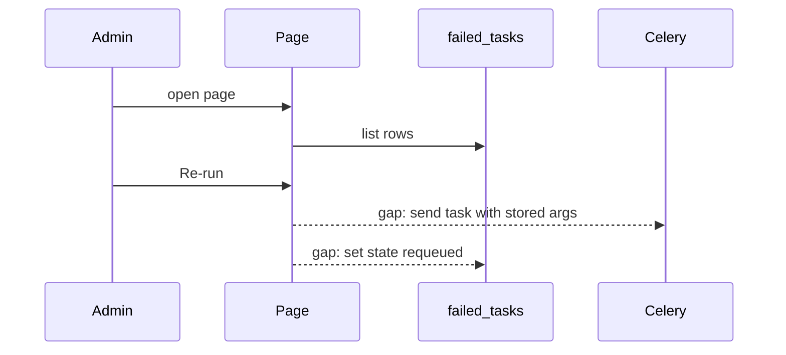
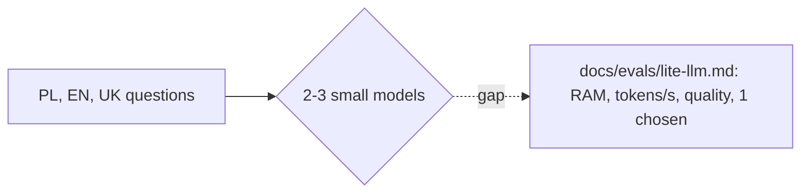
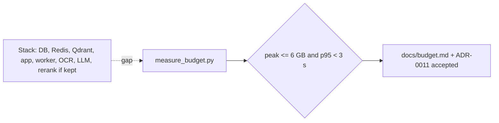
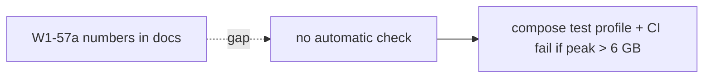

# Tickets: ops and budget (Wave 1)

Common quality gate for every code ticket: `.venv/bin/ruff check .`, `.venv/bin/ruff format --check .`, `.venv/bin/pyright`, `.venv/bin/pytest -m "not integration"`.
Path note: "(new)" means the file does not exist yet. Imports are bare, because setuptools uses `where=["src"]`. Write `from config.settings import ...` and `from core.health import ...`. Never write the `src.` prefix.
Real tree now: `src/core/observability/` is an empty package. `src/storage/` and `src/data/` have no code. `src/tasks/` has `celery_app.py` only. `tests/` has `unit/{config,plugins}` and `integration/plugins` only. `scripts/` has `seed_db.py`. `.github/workflows/` has `ci.yml` and `docs.yml`. `docker/` has `Dockerfile`, `docker-compose.yml`, `.env.example` (no `alloy/` directory, no Postgres Dockerfile). Settings is a plain class that reads `os.getenv` in `src/config/settings.py`.
After headings: every ticket has an empty "After" heading.
**OPEN (owner, applies to W1-64, W1-57a, W1-57b):** the reference CPU for every latency or RAM claim is not named. Each report states the CPU used.

---

## W1-54a Health checks: app-level DB and Redis check

**Context.** ADR-0010 (health checks, proposed) needs services to report health. Compose already has healthchecks for postgres, redis, app (`/_stcore/health`) and worker. They stay as they are. The gap: the app does not check the database and Redis, and there is no test.
**Scope.** Only a `health()` function that checks PostgreSQL and Redis and returns a status map, wired into the app, plus a unit test. Link ADR-0010 in the ADR (link only, no status change). **Non-goals.** Compose changes. Qdrant check (W1-54b). Metrics (W1-55b). Ports for outside users.
**Files.** `src/core/health.py` (new), the Streamlit app entry in `src/ui/` (wire the check, confirm file name), `tests/unit/test_health.py` (new), ADR-0010 file in `docs/adr/` (add link only). Import: `from core.health import health`.
**Depends on:** W1-18. **Blocks:** W1-54b.

```gherkin
Scenario: all services up
  Given PostgreSQL and Redis answer
  When health() runs
  Then it returns {"postgres": "up", "redis": "up"} and overall "ok"
Scenario: Redis down
  Given Redis does not answer within 2 s
  When health() runs
  Then "redis" is "down" and overall is "degraded"
  And the call returns in less than 3 s
Scenario: no secrets leak
  When health() output is logged
  Then it holds no DSN, password or host name
Scenario: ADR link
  Then ADR-0010 links to src/core/health.py
```
**Test plan.** Unit `tests/unit/test_health.py` with mocked clients.
**Quality gate.** Common gate.

### Before

### After
Fill after merge: diagram of what was built.

---

## W1-54b Add Qdrant to health

**Context.** After W1-20 Qdrant is a core service. A dead Qdrant breaks search, so health must show it.
**Scope.** Qdrant check in `health()`. Compose healthcheck for the qdrant service if W1-20 did not add one.
**Non-goals.** Neo4j check. Alerting.
**Files.** `src/core/health.py`, `docker/docker-compose.yml`, `tests/unit/test_health_qdrant.py` (new).
**Depends on:** W1-54a, W1-20. **Blocks:** none.

```gherkin
Scenario: Qdrant stopped
  Given Qdrant does not answer within 2 s
  When health() runs
  Then the map has "qdrant": "down" and overall "degraded"
Scenario: Qdrant up
  Given Qdrant answers
  Then "qdrant": "up"
Scenario: compose
  When I stop the qdrant container
  Then `docker compose ps` shows qdrant not healthy within 60 s
```
**Test plan.** Unit `tests/unit/test_health_qdrant.py` (mock client, timeout). Manual compose stop.
**Quality gate.** Common gate.

### Before

### After
Fill after merge: diagram of what was built.

---

## W1-55a structlog JSON logging with ids and PII scrub

**Context.** ADR-0005: JSON logs, PII removed at the source. No logging setup exists yet. `src/core/observability/` is an empty package and is the home of this code.
**Scope.** `configure_logging()`: JSON renderer, request id (UI) and task id (Celery) bound in context, processor that masks emails and hashes tenant id. Call it in the app and the Celery app.
**Non-goals.** OTel (W1-55b). Log shipping. Masking of free text beyond emails and tenant ids.
**Files.** `src/core/observability/logging_setup.py` (new), the Streamlit app entry in `src/ui/`, `src/tasks/celery_app.py` (exists), `tests/unit/test_logging.py` (new). Import: `from core.observability.logging_setup import configure_logging`.
**Depends on:** W1-18. **Blocks:** W1-55b.

```gherkin
Scenario: JSON line
  When I log "fetched" with request_id "r1"
  Then the line parses as JSON and has keys event, level, timestamp, request_id
Scenario: email masked
  When I log a message with "anna@example.com"
  Then the line has no "anna@example.com" and has "***@example.com" or "[redacted]"
Scenario: tenant id hashed
  When I log tenant_id "t-42"
  Then the line has no "t-42" and has a 12-char hash
Scenario: task id
  When a Celery task logs inside its run
  Then the line has the task id
Scenario: query text excluded
  When a log call passes key "query"
  Then the value is dropped (ADR-0005)
```
**Test plan.** Unit `tests/unit/test_logging.py` using `structlog.testing.capture_logs` and the real processors.
**Quality gate.** Common gate.

### Before

### After
Fill after merge: diagram of what was built.

---

## W1-55b OTel traces and metrics to Grafana Alloy

**Context.** ADR-0005 (proposed) sets OTel to local Alloy. Settings keys come from W1-18. ADR-0005 becomes `accepted` here.
**Scope.** OTel SDK init (UI and worker), `alloy` compose service with a config file and a debug exporter, span around search and task run, set ADR status to `accepted` and update `docs/adr/index.md`. The `docker/alloy/` directory does not exist: create it.
**Non-goals.** Grafana Cloud account setup. Dashboards. Any query text, user id or document text in attributes.
**Files.** `src/core/observability/telemetry.py` (new), `docker/alloy/config.alloy` (new), `docker/docker-compose.yml`, `docs/adr/0005-observability.md`, `docs/adr/index.md`, `tests/unit/test_telemetry.py` (new).
**Depends on:** W1-55a. **Blocks:** none. Alloy RAM is counted in W1-57a.

```gherkin
Scenario: Alloy starts
  When I run `docker compose up -d alloy`
  Then alloy is running and `docker compose logs alloy` has no "error" line after 30 s
Scenario: span arrives
  Given the stack runs
  When the test emits one span named "test.span"
  Then the Alloy debug exporter log shows "test.span" within 10 s
Scenario: no PII in attributes
  When a search span is made with query "rozwód"
  Then no span attribute holds "rozwód" or a raw tenant id
Scenario: ADR
  Then `docs/adr/0005-observability.md` has `status: accepted` and index.md shows "Accepted"
```
**Test plan.** Unit `tests/unit/test_telemetry.py` (in-memory exporter, attribute scrub). Integration/manual: compose and log check.
**Quality gate.** Common gate.

### Before

### After
Fill after merge: diagram of what was built.

---

## W1-56a Failed-task registry (table, migration, handler)

**Context.** ADR-0006: a failed task must not vanish. Admin re-runs it later. ADR-0006 becomes `accepted` here. Rule from DAG: the RLS policy is made in the migration that adds the table. `src/storage/` has no code now.
**Scope.** Table `failed_tasks` (task id, name, args, kwargs, traceback, state, tenant_id, timestamps). Alembic migration with RLS policy. Celery `task_failure` handler writes a row after retries end. Retry policy: exponential backoff, bounded `max_retries` (default 3). Add a `failed_tasks` case to the leak test from W1-53b.
**Non-goals.** UI (W1-56b). Stuck-task sweep (record as follow-up). Auto re-run.
**Files.** `src/storage/failed_tasks.py` (new, or method on `PostgreSQLStore` in `src/plugins/relational_db/postgres.py`), `src/tasks/celery_app.py` (exists), `migrations/versions/<rev>_failed_tasks.py` (new), `docs/adr/0006-celery-reliability.md`, `docs/adr/index.md`, `tests/integration/test_failed_tasks.py` (new), `tests/unit/test_task_retry.py` (new).
**Depends on:** none. **Blocks:** W1-56b.
**OPEN:** args may hold personal data. Default: store args, restrict by RLS and admin role. Owner confirms.

```gherkin
Scenario: failure stored
  Given a task that always raises ValueError("boom")
  When it runs and retries end (3 retries)
  Then 1 row exists with the traceback containing "boom", the args, and state "failed"
Scenario: RLS
  Then `pg_policies` has a policy on failed_tasks
  And tenant A reads 0 rows of tenant B
Scenario: migration
  When I run `alembic upgrade head` then `alembic downgrade -1`
  Then both finish with exit 0
Scenario: retry backoff
  Then retry delays grow (2x) and stop at max_retries
Scenario: ADR
  Then ADR-0006 has `status: accepted`
```
**Test plan.** Integration `tests/integration/test_failed_tasks.py` (Docker). Unit for retry settings.
**Quality gate.** Common gate, plus Docker test run from CLAUDE.md.

### Before

### After
Fill after merge: diagram of what was built.

---

## W1-56b Failed-task page with re-run (admin only)

**Context.** Requirements: admin re-runs a failed ingest from the UI. User role sees no write action.
**Scope.** Streamlit page: table of failed tasks, re-run button for `admin`, status change to `requeued`. Uses RBAC from W1-52b.
**Non-goals.** Bulk re-run. Editing args. Delete.
**Files.** `src/ui/pages/failed_tasks.py` (new, no page modules exist yet), `src/storage/failed_tasks.py` (from W1-56a), `tests/unit/test_failed_tasks_page.py` (new).
**Depends on:** W1-56a, W1-52b. **Blocks:** none.

```gherkin
Scenario: admin re-runs
  Given 1 failed row and I am admin
  When I click "Re-run"
  Then the task is sent to Celery with the stored args
  And the row state is "requeued"
Scenario: user role
  Given I am role "user"
  When I open the page
  Then I see no "Re-run" button
  And a direct call of the re-run function raises PermissionError
Scenario: tenant scope
  Then the page lists only rows of my tenant
```
**Test plan.** Unit `AppTest` with mocked store and `celery.send_task`.
**Quality gate.** Common gate.

### Before

### After
Fill after merge: diagram of what was built.

---

## W1-64 Target lite LLMs benchmark

**Context.** Budget is 4-6 GB total with a small local model. The model choice sets how much RAM is left for the rest. This is a decision and doc task.
**Scope.** Benchmark 2-3 small models (OpenAI-compatible server, quantised) on a 4-6 GB limit. Measure RAM, tokens/s, and answer quality in Polish, English, Ukrainian on 10 questions from the W1-58a query set. Choose one. Script `scripts/bench_llm.py`.
**Non-goals.** Model integration (W1-N1). Fine-tuning. Hosted LLMs.
**Files.** `docs/evals/lite-llm.md` (new), `scripts/bench_llm.py` (new), `data/eval/queries.jsonl` (read only, from W1-58a).
**Depends on:** W1-58a. **Blocks:** W1-57a.
**OPEN:** reference CPU is not named (owner item, DAG flag 10). Report the CPU used.

```gherkin
Scenario: report complete
  Then docs/evals/lite-llm.md lists 2 to 3 models
  And each has RAM (GB) and tokens/s measured under a 4-6 GB limit
  And each has a quality score for PL, EN and UK
  And the report names the CPU used
Scenario: choice
  Then exactly one model is marked "chosen"
  And its peak RAM is <= 3 GB (leaves room for the 6 GB total) or the report states the exact headroom
Scenario: reproducible
  When I run `python scripts/bench_llm.py --help`
  Then it exits 0 and lists the model and limit options
```
Note: the 3 GB share is a proposal. Owner confirms. W1-57a sets the final split.
**Test plan.** No unit test of results. Unit test for report parser in `tests/unit/test_bench_llm.py` (new) if the script has parsing logic.
**Quality gate.** Common gate (for the script).

### Before

### After
Fill after merge: diagram of what was built.

---

## W1-57a Efficiency budget, SLA doc and measure script (rerank parts CONDITIONAL on W1-58r)

**Context.** ADR-0011 (proposed) sets 4-6 GB and p95 < 3 s. This task measures the real stack. ADR-0011 becomes `accepted` here. The rerank parts are CONDITIONAL on W1-58r. If W1-58r drops rerank, the stack has no rerank model: the rerank RAM line and the rerank latency line are skipped, and the other lines stay.
**Scope.** `scripts/measure_budget.py`: start the stack under `mem_limit: 6g` (postgres, redis, qdrant, app, worker, alloy, OCR, search, and the loaded rerank model (CONDITIONAL)), print RAM per service and the rerank model on its own line (CONDITIONAL), run search load, print p95 and the CPU used. If rerank is dropped, the script prints no rerank RAM line and no rerank latency line, and it does not fail because of their absence. Fill the budget table in `docs/`. Set ADR to `accepted`.
**Rule.** Peak RAM <= 6 GB under `mem_limit` 6g, including the rerank model (CONDITIONAL). p95 hybrid search < 3 s. The run uses rerank on (CONDITIONAL). If rerank is dropped, the same limits apply to the stack without it.
**Non-goals.** CI enforcement (W1-57b). Tuning code for speed (open new tickets).
**Files.** `scripts/measure_budget.py` (new), `docs/budget.md` (new), `docs/adr/0011-sla-budget.md`, `docs/adr/index.md`, `docker/docker-compose.yml` (mem_limit only for the measure run), `tests/unit/test_measure_budget.py` (new, parser).
**Depends on:** W1-64, W1-59b, W1-24, W1-35a, W1-58r. **Blocks:** W1-57b.
**OPEN:** if the sum is above 6 GB, report it. Do not change the design. Escalate to the owner (descope or smaller model).
**OPEN:** reference CPU for the p95 and RAM claims is not named. Owner names it. The budget doc states the CPU used.

```gherkin
Scenario: RAM within budget
  Given the full stack with mem_limit 6g
  When I run `python scripts/measure_budget.py`
  Then it prints RAM per service
  And the peak total is <= 6 GB
Scenario: rerank RAM line (CONDITIONAL on W1-58r)
  Given W1-58r keeps rerank and the rerank model is loaded
  When I run `python scripts/measure_budget.py`
  Then it prints a separate "rerank model" line
  And the rerank model RAM is counted in the peak total
Scenario: rerank dropped (CONDITIONAL on W1-58r)
  Given W1-58r drops rerank
  When I run `python scripts/measure_budget.py`
  Then the output has no "rerank model" line and no rerank latency line
  And the script exits 0 if the other limits hold
Scenario: latency
  When the script runs the search load (rerank on if W1-58r keeps rerank)
  Then p95 hybrid search latency < 3 s
  And the output names the CPU used
Scenario: rerank latency line (CONDITIONAL on W1-58r)
  Given W1-58r keeps rerank
  Then the output has a rerank latency line
Scenario: no OOM
  Then no container is OOM-killed during the run
Scenario: docs and ADR
  Then docs/budget.md has a filled table (service, RAM, limit)
  And ADR-0011 has `status: accepted`
```
**Test plan.** Unit test of the output parser and the pass/fail rule, including a case with no rerank lines. Full run is manual/Docker (integration).
**Quality gate.** Common gate.

### Before

### After
Fill after merge: diagram of what was built.

---

## W1-57b Enforce the budget in compose and CI

**Context.** A measured budget decays unless a check fails when it is broken.
**Scope.** `mem_limit: 6g` on the test profile or a group limit as chosen in W1-57a. Smoke check that fails if peak RAM > 6 GB. Add the step to `.github/workflows/ci.yml` (exists).
**Non-goals.** New measurement logic (use W1-57a). Latency gate in CI unless W1-57a shows stable numbers.
**Files.** `docker/docker-compose.yml`, `.github/workflows/ci.yml`, `scripts/measure_budget.py` (`--check` flag), `tests/unit/test_budget_check.py` (new).
**Depends on:** W1-57a. **Blocks:** none.
**OPEN:** reference CPU is not named (owner item). A CI runner differs from the reference CPU, so the RAM limit is the gate and latency is not.

```gherkin
Scenario: over budget fails
  Given a measured peak of 6.2 GB
  When the check runs
  Then it exits non-zero and prints the peak and the limit
Scenario: within budget passes
  Given a measured peak of 5.4 GB
  Then the check exits 0
Scenario: compose limit
  Then `docker compose config` shows mem_limit 6g on the budget services
Scenario: CI
  Then the CI job with the smoke check is green on main
```
**Test plan.** Unit `tests/unit/test_budget_check.py` (threshold logic). CI run as proof.
**Quality gate.** Common gate.

### Before

### After
Fill after merge: diagram of what was built.
