# Tickets: search, review, citations, OCR (Wave 1)

Gate for every code ticket: `ruff check`, `ruff format --check`, `pyright`, `.venv/bin/pytest -m "not integration"`.
Path note: repo code uses bare imports (`from config.settings ...`, `from data.models ...`). Setuptools uses `where=["src"]`, so never write a `src.` prefix. Files marked (new) do not exist yet. `src/data/__init__.py` and `src/agents/__init__.py` exist. `src/ui/pages/*` and `src/ui/components/auth.py` do not exist.

---
## #26m Add document `status` column and reject audit (Alembic)
**Context.** Migration `4439761c5e40` created `legal_document`, `tenants`, `users`. It may not be the current head (verify with `alembic heads`). RLS is on `tenants` and `users` only. `legal_document` has these columns: id, title, content, source, source_url, last_updated, metadata (JSONB), is_processed, tenant_id (nullable). It has NO `status` column. Review (#26b, #26c) and search (#35a) need one. Reject needs an audit table so the same source is not fetched again.
**Scope.** Add `status` to `legal_document` with values `needs_review` and `approved` only (CHECK constraint). Existing rows are backfilled `approved`. New rows default to `needs_review`. Add `status` to the `LegalDocument` model. The same migration creates the reject audit table (document id, source URL, admin, time). Add store methods `reject(document_id, admin)` and `is_rejected(source_url)`. `reject` deletes the document row, writes 1 audit row, and calls a delete hook `on_document_deleted(document_id)`. `reject` does not call Qdrant itself. The hook is an optional callable on the store (default none). The caller wires it (#26c wires it to Qdrant). Chunks are removed by the foreign key cascade from #26a, not by this ticket. `is_rejected` returns true if an audit row has that source URL. Migration has a working downgrade. **Non-goals:** no `rejected` value (reject is a hard delete), no `approve` (that is #26b), no UI (#26c), no Qdrant code, no chunk code, no RLS change, no index on `status`.
**Files.** `migrations/versions/<new>.py` (new, `down_revision` = current Alembic head: **verify** with `alembic heads`, do not assume `4439761c5e40`), `src/data/models.py` (from #16: add `status`), `src/plugins/relational_db/postgres.py` (add `reject`, `is_rejected`, optional `on_document_deleted` hook), `tests/integration/test_document_status_migration.py` (new), `tests/integration/test_reject_document.py` (new), `tests/unit/test_data_models.py` (extend).
**Depends on:** #16. **Blocks:** #10, #22b, #26b, #26c, #35a, #59b.
**Acceptance.**
```gherkin
Scenario: Existing rows become approved
  Given a database at the previous head with 3 rows in legal_document
  When I run alembic upgrade head
  Then all 3 rows have status "approved"
Scenario: New rows default to needs_review
  Given the upgraded database
  When I insert a row without a status
  Then its status is "needs_review"
Scenario: Bad value rejected
  When I insert a row with status "bogus"
  Then the database raises a constraint error
Scenario: Only two values
  When I insert a row with status "rejected"
  Then the database raises a constraint error
Scenario: Downgrade
  When I run alembic downgrade -1 and then upgrade head
  Then both finish without error
  And the status column and the audit table are absent after the downgrade
Scenario: Model matches schema
  When I run alembic autogenerate after the upgrade
  Then it finds 0 schema changes
Scenario: RLS unchanged
  Then RLS is still enabled on tenants and users only
Scenario: Reject deletes the row
  Given 1 document
  When reject(document_id, admin) is called
  Then the document row is gone (0 rows)
Scenario: Reject calls the delete hook
  Given 1 document and a mocked hook set as on_document_deleted
  When reject(document_id, admin) is called
  Then the hook is called once with the document id
Scenario: Reject without a hook
  Given 1 document and no on_document_deleted hook set
  When reject(document_id, admin) is called
  Then the document row is deleted
  And 1 audit row exists
  And no error is raised
Scenario: Reject writes audit
  When an admin rejects a document with source_url "https://example.pl/a"
  Then 1 audit row exists with document id, source URL "https://example.pl/a", admin and time
Scenario: Audited URL
  Given an audit row for "https://example.pl/a"
  Then is_rejected("https://example.pl/a") returns true
  And is_rejected("https://example.pl/b") returns false
Scenario: Unknown document
  When reject is called with an id that does not exist
  Then a clear error is raised, no audit row is written and the hook is not called
```
**Test plan.** Integration `tests/integration/test_document_status_migration.py` and `tests/integration/test_reject_document.py` (Docker, real PostgreSQL, hook mocked). Unit check that `LegalDocument` has a `status` field.
**Hint.** Add the column with `server_default='approved'` to fill old rows, then alter the default to `needs_review`.
**Before.**
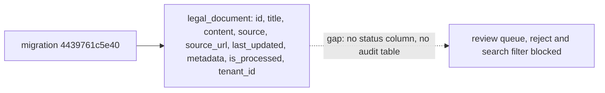
### After
Fill after merge: diagram of what was built.

---
## #26a DocumentProcessorAgent part 1: chunking and metadata
**Context.** Documents must become chunks with metadata before embedding. Serves the review queue and search. `src/agents/` has only `__init__.py`.
**Scope.** Split text into chunks with start/end offsets. Add metadata: area, jurisdiction, doc type, date. Keep `source_url`. Create the chunks table (Alembic migration). The foreign key from a chunk to its document uses `ON DELETE CASCADE`, so deleting a document removes its chunks (#26m reject relies on this). **Non-goals:** embedding, Qdrant, OCR.
**Files.** `src/agents/document_processor.py` (new), `src/data/models.py` (from #16: add `Chunk` with the cascade foreign key), `migrations/versions/<new>_chunks.py` (new, `down_revision` = current Alembic head: **verify** with `alembic heads`), `tests/unit/test_processor_chunking.py` (new), `tests/integration/test_chunk_cascade.py` (new).
**Depends on:** #16, #22a. **Blocks:** #26b, #59b.
**Acceptance.**
```gherkin
Scenario: Chunks keep offsets and source
  Given a LegalDocument with text of 5000 characters and source_url "https://example.pl/a"
  When the agent chunks it
  Then every chunk has start and end offsets and text equals document text[start:end]
  And every chunk has source_url "https://example.pl/a"
Scenario: Metadata is set
  Given a document with area "family" and doc type "act"
  When the agent chunks it
  Then each chunk has area, jurisdiction, doc type and date fields
Scenario: Empty text
  Given a document with empty text
  When the agent chunks it
  Then the result is 0 chunks and no exception
Scenario: Delete cascades to chunks
  Given 1 document with 3 stored chunks
  When the document row is deleted
  Then its chunks are gone (0 rows)
Scenario: Foreign key rule
  Then the chunks foreign key to the document has ON DELETE CASCADE
```
**Test plan.** Unit: `tests/unit/test_processor_chunking.py`. Integration (Docker, real PostgreSQL): `tests/integration/test_chunk_cascade.py`.
**Before.**
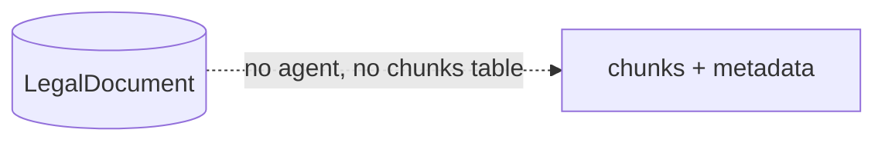
### After
Fill after merge: diagram of what was built.

---
## #26b DocumentProcessorAgent part 2: embed, index, needs_review
**Context.** Chunks need vectors in Qdrant. New documents stay hidden until an admin approves them. The `status` column comes from #26m.
**Scope.** Embed chunks (#24), upsert to Qdrant (#20) with a `status` payload. New documents keep the default `needs_review` from #26m. Add store call `approve(doc_id)`: set `approved`, update point payload. **Non-goals:** UI, reject flow (#26m), any migration (#26m owns the column).
**Files.** `src/agents/document_processor.py`, `src/plugins/relational_db/postgres.py` (add `approve`), `tests/integration/test_processor_index.py` (new).
**Depends on:** #26a, #24, #20, #26m. **Blocks:** #26c, #35a.
**Acceptance.**
```gherkin
Scenario: Process one document
  Given a document that gives N chunks
  When the agent processes it
  Then Qdrant holds N points for that document
  And the document status is "needs_review"
  And every point payload has status "needs_review"
Scenario: Approve
  Given a document with status "needs_review"
  When approve(doc_id) is called
  Then status is "approved" and every point payload has status "approved"
Scenario: Unknown document
  When approve(doc_id) is called with an id that does not exist
  Then a clear error is raised and nothing changes
```
**Test plan.** Integration: `tests/integration/test_processor_index.py` (Docker). Unit with mocked embed and Qdrant for the agent flow.
**Before.**
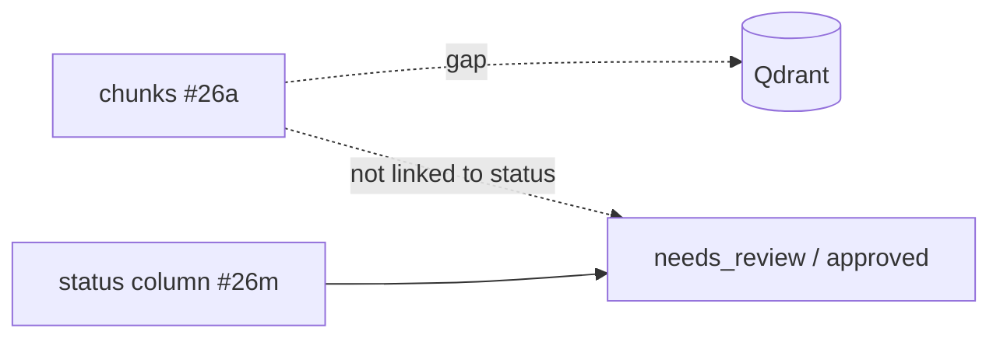
### After
Fill after merge: diagram of what was built.

---
## #26c Review queue page
**Context.** An admin must approve documents before users see them (requirements, Edge Cases). Auth components come from #52a/#52b. `src/ui/components/auth.py` and `src/ui/pages/*` do not exist today.
**Scope.** Page lists `needs_review` documents: text, source, origin (scan or text). Admin approves (calls `approve` from #26b) or rejects (calls `reject(document_id, admin)` from #26m). The page (or its store setup) wires the store hook `on_document_deleted` to the Qdrant delete-by-document function from #20 (name set by that ticket). So after a reject, the Qdrant points of that document are deleted. The delete, the audit table, the audit row and `is_rejected` belong to #26m. Role `user` sees nothing. Use the role check that #52a/#52b create. **Non-goals:** bulk actions, edit of text, migrations, store methods, writing the Qdrant delete function (#20).
**Files.** `src/ui/pages/review_queue.py` (new), role-check helper from #52a/#52b (path set by that ticket, do not assume `src/ui/components/auth.py` exists), `tests/unit/test_review_queue_page.py` (new), `tests/integration/test_review_reject_qdrant.py` (new).
**Depends on:** #26b, #26m, #20, #52b. **Blocks:** none.
**Acceptance.**
```gherkin
Scenario: Admin approves
  Given an admin session and 1 document with status "needs_review"
  When the admin clicks "Approve"
  Then the document status is "approved"
Scenario: Reject calls the store
  Given an admin session, 1 document and a mocked store
  When the admin clicks "Reject"
  Then reject is called once with that document id and the admin name
  And the document is not in the queue
Scenario: Hook is wired to Qdrant
  Given the page is set up
  Then the store on_document_deleted hook is the Qdrant delete-by-document function from #20
Scenario: Reject removes Qdrant points
  Given 1 document with 3 Qdrant points
  When the admin rejects it
  Then no Qdrant point for that document id exists (0 points)
Scenario: User role
  Given a session with role "user"
  When the page loads
  Then there is no queue list and 0 buttons named "Approve" or "Reject"
Scenario: Origin shown
  Given a queued document from OCR
  Then the row shows origin "scan"
```
**Test plan.** Unit, Streamlit `AppTest`: `tests/unit/test_review_queue_page.py`, store mocked. Integration (Docker, real PostgreSQL and Qdrant): `tests/integration/test_review_reject_qdrant.py`. Delete, audit and no re-fetch are tested in #26m, #10 and #22b.
**Before.**
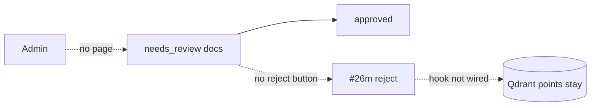
### After
Fill after merge: diagram of what was built.

---
## #62a Faceted filters in the store
**Context.** Users filter by area, jurisdiction, type, date (ADR-0008, P0).
**Scope.** Store method for facet counts and filter params. Filters combine with AND. **Non-goals:** UI, vector payload filters.
**Files.** `src/plugins/relational_db/postgres.py` (add `facet_counts`, filter args to `search_documents`), `tests/integration/test_facets.py` (new).
**Depends on:** #85, #16. **Blocks:** #35a.
**Acceptance.**
```gherkin
Scenario: Counts match rows
  Given 10 documents: 6 area "family", 4 area "tax"
  When facet_counts is called
  Then family is 6 and tax is 4
Scenario: AND filters
  When area "family" and type "act" are applied
  Then only rows with both values return
Scenario: Tenant safety
  Given RLS is on
  Then counts never include another tenant's rows (0)
Scenario: No match
  Then the result is an empty list, not an error
```
**Test plan.** Integration `tests/integration/test_facets.py`.
**Before.**
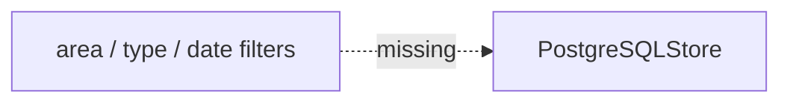
### After
Fill after merge: diagram of what was built.

---
## #35p Rerank model packaging (CONDITIONAL on #58r)
**Context.** The local rerank model must reach the host without entering git. This part was split out of #35a to keep tickets small.
**Scope.** Add `scripts/fetch_rerank_model.py`: it downloads the model named in `docs/evals/rerank.md` to `rerank_model_path`. Add a compose named volume mounted at `rerank_model_path`. Add a check that no model file is tracked in git. **Non-goals:** search logic, rerank code (#35a), model choice (#58r), download without owner approval.
**Files.** `scripts/fetch_rerank_model.py` (new), `docker/docker-compose.yml` (named volume), `tests/unit/test_fetch_rerank_model.py` (new, mocked download), `tests/unit/test_model_not_tracked.py` (new, runs `git ls-files`).
**Depends on:** #18, #58r. **Blocks:** #35a. (Confirmed by owner.)
**CONDITIONAL:** this ticket is dropped if the #58r outcome rule gives "no rerank" (no rerank is within 0.02 recall@5 of the best reranker for every language, or no model meets the limits). Then #35a does FTS + vector fusion only.
**OPEN:** model name waits for #58r. Download needs owner approval.
**Acceptance.**
```gherkin
Scenario: Download to the path
  Given a mocked download of the model
  When the script runs with rerank_model_path set to a temp dir
  Then the model files are in that dir
Scenario: Re-run is safe
  Given the files already exist
  When the script runs again
  Then it skips the download and exits 0
Scenario: Download failure
  Given a mocked network error
  Then the script exits non-zero with a clear message and leaves no partial file
Scenario: Not in git
  Then `git ls-files` lists no model file (.onnx, .bin, .safetensors)
Scenario: Volume
  Then docker-compose.yml mounts a named volume at rerank_model_path
```
**Test plan.** Unit with mocks and `git ls-files`. Compose check by parsing `docker/docker-compose.yml`.
**Before.**
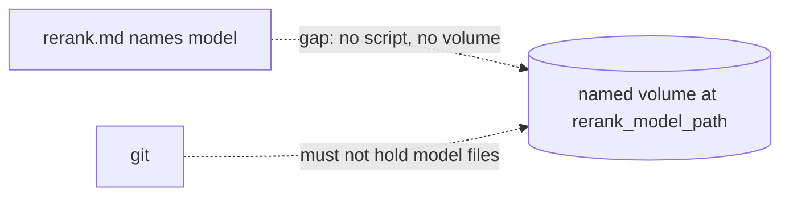
### After
Fill after merge: diagram of what was built.

---
## #35a Hybrid search service with local rerank (rerank parts CONDITIONAL on #58r)
**Context.** Search needs FTS + vector fusion and a local rerank. No data leaves the host. Model files come from #35p. If #58r drops rerank, this ticket does FTS + vector fusion only. Then all rerank scope, scenarios and files below fall away and #35p is dropped.
**Scope.** Fuse FTS (#85) and vector (#20) results, apply filters, rerank 20-50 pairs with the model named in `docs/evals/rerank.md` (CONDITIONAL). Search `approved` only (column from #26m). If the rerank model is missing or fails to load, raise an explicit error (hard error, owner decision 2026-11-01). No silent fallback and no `reduced_ranking` flag. There is no `rerank_enabled` setting. A slow rerank call is not a failure, and there is no runtime timeout switch. **Non-goals:** UI, citations, model download, packaging (#35p).
**Files.** `src/core/search/hybrid.py` (new), `src/core/search/rerank.py` (new, CONDITIONAL), `src/config/settings.py` (keys from #18, read only), `tests/integration/test_hybrid_search.py`, `tests/integration/test_rerank_latency.py` (new, CONDITIONAL).
**Depends on:** #85, #62a, #26b, #26m, #18, #58r, #35p (CONDITIONAL). **Blocks:** #35b, #35c, #63a, #57a.
**Acceptance.**
```gherkin
Scenario: Expected hit
  Given the eval corpus is approved and indexed
  When a known query runs
  Then the expected doc is in the top 3
Scenario: Unapproved hidden
  Given a "needs_review" document that matches
  Then it is not in the results
Scenario: Model missing (CONDITIONAL)
  Given no model files at rerank_model_path
  When a search runs
  Then an explicit error is raised and no results return
  And the error names the missing model path
Scenario: Model load failure (CONDITIONAL)
  Given corrupt model files at rerank_model_path
  When a search runs
  Then an explicit error is raised and no results return
Scenario: No silent fallback (CONDITIONAL)
  Given the model is missing
  Then the response has no reduced_ranking field and no unreranked results
Scenario: Slow rerank is not a failure (CONDITIONAL)
  Given a mocked rerank slower than 500 ms
  Then reranked results return and no error is raised
Scenario: Latency (perf test only, CONDITIONAL)
  When 20-50 pairs are reranked on CPU
  Then time is below 500 ms on the reference CPU (the machine that ran #58r)
  And in CI the limit is 1000 ms (2x)
```
**Test plan.** Integration `test_hybrid_search.py`, perf `test_rerank_latency.py` (the limit is checked here only, never at runtime). Unit tests with mocks for the error paths.
**Reference CPU rule (owner decision).** The 500 ms limit applies on the machine that ran #58r. Its report prints the CPU model. CI uses 2x (1000 ms).
**OPEN:** Rerank model name waits for #58r.
**Before.**
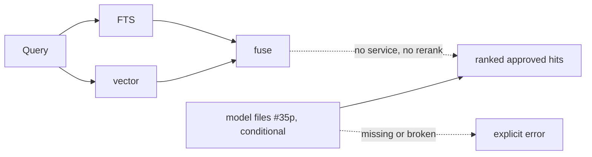
### After
Fill after merge: diagram of what was built.

---
## #35b Streamlit search page with facet sidebar
**Context.** Users need a UI for search. A rerank model error must be visible. This rerank part is CONDITIONAL on #58r: if rerank is dropped, no rerank error exists and the "Error shown" and "Error absent" scenarios fall away. `src/ui/pages/*` does not exist yet.
**Scope.** Search box, facet sidebar (counts from #62a), result list. Show the search error text when the service raises the rerank model error (CONDITIONAL). There is no `rerank_enabled` setting. **Non-goals:** citations, write actions.
**Files.** `src/ui/pages/search.py` (new), `tests/unit/test_search_page.py` (new).
**Depends on:** #35a, #52b. **Blocks:** #63b.
**Acceptance.**
```gherkin
Scenario: Filter changes results
  Given a mocked service with 2 areas
  When the user picks area "tax"
  Then the list shows only "tax" results
Scenario: Error shown (CONDITIONAL)
  Given the service raises the rerank model error
  Then the page shows the error text and no result list
Scenario: Error absent (CONDITIONAL)
  Given the service returns hits
  Then the page shows no error text
Scenario: Empty
  Given 0 hits
  Then the page shows "no results" and no error
```
**Test plan.** Unit, `AppTest`: `tests/unit/test_search_page.py`.
**Before.**
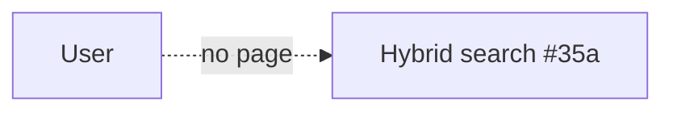
### After
Fill after merge: diagram of what was built.

---
## #35c Hybrid search eval and latency
**Context.** Prove recall and speed targets (requirements, Success Metrics).
**Scope.** Script runs the #58a queries (PL, EN, UK) with rerank on. Writes report. **Non-goals:** tuning the model, code changes in search.
**Files.** `scripts/eval_search.py` (new), `docs/evals/search.md` (new), `tests/unit/test_eval_search.py` (new, metric math).
**Depends on:** #35a, #58a. **Blocks:** none.
**Acceptance.**
```gherkin
Scenario: Recall
  When the script runs on the corpus
  Then recall@5 >= 0.80 for Polish, English and Ukrainian
Scenario: Cross-language
  Given a Ukrainian question in the eval set
  Then the expected Polish article is in the top 5
Scenario: Latency
  Then p95 hybrid search latency < 3 s
Scenario: Report
  Then docs/evals/search.md lists recall@5 per language and p95
```
**Test plan.** Unit for recall and p95 functions. The eval run itself is manual in the Docker stack.
**OPEN:** If a target fails, the fix belongs to #35a or #58, not to this ticket.
**Before.**
```mermaid
flowchart LR
  Qs[queries.jsonl] -. no script .-> M[recall@5, p95]
```
### After
Fill after merge: diagram of what was built.

---
## #63a Citations with confidence
**Context.** Every answer needs source links and a score. Low confidence gives a refusal (ADR-0008, P0). This ticket also owns the shared "not legal advice" text.
**Scope.** Citation model (`source_url`, quote, `confidence`). Score from retrieval + rerank (document the rule). Below `min_confidence` (0.5) or no citation: "no reliable answer" plus closest sources. Define the shared constant `NOT_LEGAL_ADVICE_NOTICE` (text "not legal advice") in `src/core/notices.py`. #63b imports it. Set ADR-0008 to `accepted` and update `docs/adr/index.md`. **Non-goals:** UI, LLM answer text.
**Files.** `src/core/citations.py` (new), `src/core/notices.py` (new), `src/data/models.py`, `docs/adr/0008-mvp-scope.md`, `docs/adr/index.md`, `tests/unit/test_citations.py` (new).
**Depends on:** #35a. **Blocks:** #61b, #63b.
**Acceptance.**
```gherkin
Scenario: Valid citations
  Given hits from search
  Then every citation has source_url and confidence in [0,1]
Scenario: Below threshold
  Given confidence 0.4 and default min_confidence 0.5
  Then the result is "no reliable answer" with the closest sources
Scenario: No citation
  Then the result is "no reliable answer" with the closest sources
Scenario: Setting changes outcome
  Given confidence 0.4 and min_confidence 0.3
  Then the result is a normal answer
Scenario: Shared notice
  Then core.notices.NOT_LEGAL_ADVICE_NOTICE exists and contains "not legal advice"
Scenario: ADR
  Then docs/adr/0008-mvp-scope.md status is "accepted"
```
**Test plan.** Unit `tests/unit/test_citations.py`.
**OPEN:** Owner confirms the ADR-0008 mapping (flag 1).
**Before.**
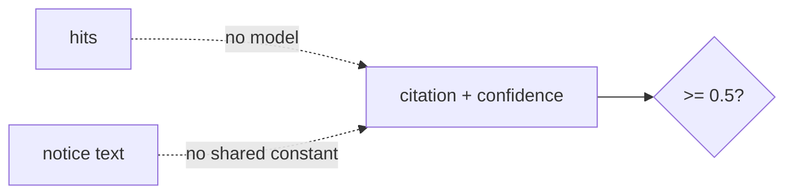
### After
Fill after merge: diagram of what was built.

---
## #63b Render citations in UI
**Context.** Users must see the link, score and quote. The notice keeps answers information-only.
**Scope.** Show score, link, quote per hit. Show the notice `NOT_LEGAL_ADVICE_NOTICE` (defined in #63a, `core.notices`) on every answer view, also for "no reliable answer". Do not copy the text into the UI. **Non-goals:** citation logic, defining the notice text.
**Files.** `src/ui/components/citations.py` (new), `src/ui/pages/search.py` (from #35b), `tests/unit/test_citations_ui.py` (new).
**Depends on:** #63a, #35b. **Blocks:** none.
**Acceptance.**
```gherkin
Scenario: Hit fields
  Given 3 cited hits
  Then each shows a link, a score and a quote
Scenario: Notice with citations
  Then the view contains NOT_LEGAL_ADVICE_NOTICE
Scenario: Notice on refusal
  Given "no reliable answer"
  Then the view contains NOT_LEGAL_ADVICE_NOTICE and the closest sources
Scenario: Missing notice fails
  Given a view rendered without the notice
  Then the test fails
```
**Test plan.** Unit, `AppTest`: `tests/unit/test_citations_ui.py`.
**Before.**
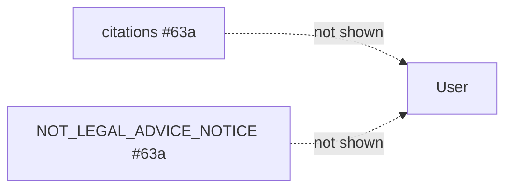
### After
Fill after merge: diagram of what was built.

---
## #59a OCR eval (Polish scans)
**Context.** Scans are in the MVP. Pick one engine by quality and RAM (budget 4-6 GB).
**Scope.** Compare engines on Polish scans: CER and RAM per engine. Name one. Set a CER threshold for #59b. **Non-goals:** integration in the agent.
**Files.** `scripts/eval_ocr.py` (new), `data/eval/ocr/` (new, scan samples with ground truth), `docs/evals/ocr-pl.md` (new), `tests/unit/test_eval_ocr.py` (new, CER function).
**Depends on:** none. **Blocks:** #59b.
**Acceptance.**
```gherkin
Scenario: Report
  When the script runs
  Then docs/evals/ocr-pl.md lists CER and peak RAM per engine
Scenario: Choice
  Then exactly one engine is marked "chosen" and a CER threshold is stated
Scenario: CER function
  Given "ala ma kota" and "ala ma kota"
  Then CER is 0.0
```
**Test plan.** Unit for the CER function. The engine run is manual.
**OPEN:** Engine list, sample scans and their licence need owner approval. Engine RAM limit must fit the 6 GB budget with other services.
**Before.**
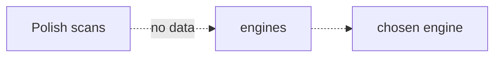
### After
Fill after merge: diagram of what was built.

---
## #59b OCR integration in DocumentProcessorAgent
**Context.** Scanned PDFs and images must enter the same chunk and review path.
**Scope.** Detect scan or image input, run the engine from #59a, pass text to chunking. Mark origin "scan". New documents from OCR start as `needs_review` (the `status` column comes from #26m). **Non-goals:** new engines, layout analysis.
**Files.** `src/agents/document_processor.py`, `src/agents/ocr.py` (new), `pyproject.toml` (engine dependency), `tests/fixtures/scan.pdf`, `tests/fixtures/scan.png` (new), `tests/unit/test_processor_ocr.py` (new).
**Depends on:** #59a, #26a, #26m. **Blocks:** #57a.
**Acceptance.**
```gherkin
Scenario: Scanned PDF
  Given tests/fixtures/scan.pdf
  When the agent processes it
  Then text is extracted and CER is below the #59a threshold
  And chunks keep source_url and status is "needs_review"
Scenario: PNG
  Given tests/fixtures/scan.png
  Then the same results hold
Scenario: Text PDF
  Given a PDF with a text layer
  Then OCR is not called
Scenario: OCR failure
  Given a corrupt image
  Then the agent raises a clear error and no document is saved as approved
```
**Test plan.** Unit `tests/unit/test_processor_ocr.py`. Mark as integration if the engine needs system packages not in the venv.
**OPEN:** Dependency may need system libs in the Docker image. Check after #59a.
**Before.**
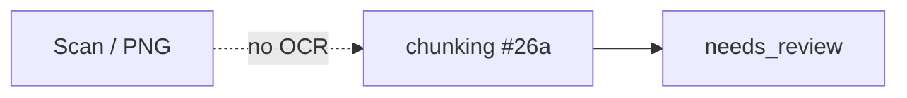
### After
Fill after merge: diagram of what was built.
